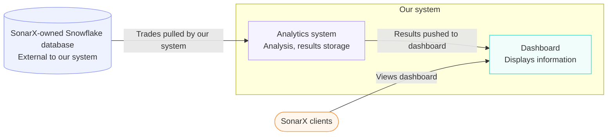

# Design — Wallet analytics architecture and data model

> Epic: #24, #29, #33 · Stories: #25, #26 · Feature: #85
> Owner: Kyle Quach · Sprint: 3 · Status: draft
> Specification: [`../specs/example-spec.md`](../specs/example-spec.md)

## 1. System context

Who and what is outside our boundary, and what crosses it.

```mermaid
flowchart LR
  DB[("SonarX-owned Snowflake database")] -->|Source data| Analysis["Pull trades"]
  Analysis --> Positions["Build positions"]
  Positions --> PnL["Compute PnL"]
  PnL --> Ranking["Rank wallets"]
  Ranking -->|Produces| Results["Data results"]
  Results -.->|Stored in| Storage[("Results storage<br>Pending #52")]
  Storage -.->|Visualized in| Dashboard["Dashboard"]

  DB:::data
  Results:::data
  Storage:::data
  Analysis:::processing
  Positions:::processing
  PnL:::processing
  Ranking:::processing
  Dashboard:::presentation

  classDef data fill:#eef2ff,stroke:#818cf8
  classDef processing fill:#f5f3ff,stroke:#a78bfa
  classDef presentation fill:#f0fdfa,stroke:#2dd4bf
```

*Figure 1 — High-level architecture. Solid lines are built; dashed lines depend on results storage (#52).*

*Figure 2 — System context. The database is external. Clients interact only with the dashboard.*

## 2. Components

| Component | Responsibility | Interface | Where |
|---|---|---|---|
| Pull trades | reads raw trades from the SonarX Snowflake database | 〈TBD〉 | 〈TBD〉 |
| Build positions | turns trades into per-wallet positions | 〈TBD〉 | 〈TBD〉 |
| Compute PnL | computes profit and loss per wallet from positions | 〈TBD〉 | 〈TBD〉 |
| Rank wallets | orders wallets by PnL and produces the data results | 〈TBD〉 | 〈TBD〉 |
| Results storage | holds results for the dashboard (pending #52) | 〈TBD〉 | 〈TBD〉 |
| Dashboard | displays results to SonarX clients | 〈TBD〉 | 〈TBD〉 |

## 3. Data model

Figure 1 shows the whole model. Read it from the top: trades and market
resolutions come in from SonarX, the pipeline groups the trades into positions
and lots, and the wallet totals and metrics are built from the positions.

*Figure 2 — Entity-relationship model. Trades are read from the external source; positions, PnL results, and ranks are derived and written to results storage (pending #52).*

## 4. Data flow (level 1)
![Level 1 data flow: process 1.0 extracts trades and resolutions from SonarX Snowflake into store D1; 2.0 builds positions and FIFO lots into D2; 3.0 reads resolutions from D1 and positions from D2 and writes open or closed status back to D2; 4.0 reads lots and status from D2 and prices and payouts from D1 and writes PNL to D3; 5.0 reads D3 and closed positions from D2 and writes rankings and metrics to D4; 6.0 reads D2, D3 and D4 and serves the leaderboard and wallet lookup pages to the SonarX client](diagrams/dfd-level1.png)

*Figure 2 — Level 1 DFD. Source: [`diagrams/dfd-level1.mmd`](diagrams/dfd-level1.mmd).
Rectangles are processes, numbered as in the specification; cylinders are data
stores; rounded boxes are external entities.*

## 5. Key decisions

| Decision | Options considered | Chosen | Why |
|---|---|---|---|
| Source of trade data | SonarX Snowflake database · other feeds | SonarX Snowflake database | it is the data provider's own store and the system's single source of truth |
| Results storage | 〈TBD〉 | pending #52 | not yet decided; the dashboard depends on it (dashed lines in Figure 3) |
| Ranking metric | 〈TBD〉 | 〈TBD〉 | 〈TBD〉 |

## 6. What is NOT designed yet

Results storage is pending #52, so the path from results to dashboard is dashed in Figure 3. 〈Add other out-of-scope items per the specification.〉 They have no boxes in Figure 1 on purpose — an empty space in a diagram is information.
