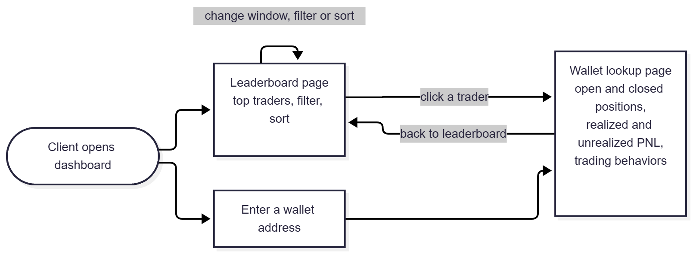

> Epic: #33 · Stories: #34, #35, #36

# Dashboard page flow

Figure 1 shows how a SonarX client moves between dashboard pages. Each page answers questions in `docs/specs/dashboard-questions.md`.

*Figure 1 — Page flow. How does a client get from the top traders to the details of one wallet? Source: `dashboard-flow.mmd`.*

Figure 1 is a dashboard organized around two entry points that both lead to a single wallet lookup page. When a client opens the dashboard, they can either land on the leaderboard page or enter a wallet address directly. The leaderboard page shows the top traders and lets the client change the time window, apply filters, or re-sort the list without leaving the page. Selecting a trader from the leaderboard opens the wallet lookup page for that trader, and entering a wallet address takes the client to the same page. The wallet lookup page shows the wallet’s open and closed positions, its realized and unrealized PNL, and its trading behaviors. From there, the client can return to the leaderboard to keep browsing. This flow keeps navigation shallow, since every page is at most one step from the others, and supports both discovery of top traders and lookup of a specific wallet (#97).

## Pages and the questions they answer

| Page | Story | Questions answered |
|------|-------|--------------------|
| Leaderboard | #35 | Q1, Q5 |
| Wallet lookup | #36 | Q4, Q6, Q7 |
