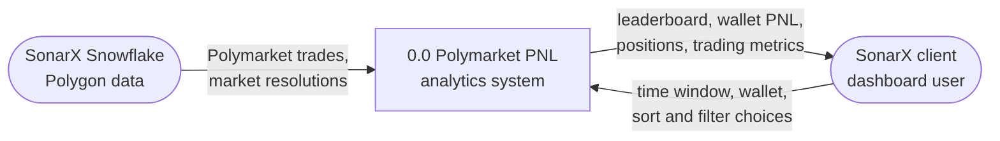

# Design — Data flow from SonarX's Polygon data to the dashboard

> Epic: #24, #29, #33 · Stories: #25, #26, #27, #30, #31, #35, #36 · Task: #58
> Owner: Bryan Orozco · Sprint: 2 · Status: draft
> Specification: [`../specs/pnl-calculation.md`](../specs/pnl-calculation.md)

*How data moves from SonarX's Snowflake tables through position matching,
PNL, ranking and metrics to the dashboard. Process numbers match the pipeline
steps in the specification: process 1.0 is step 1, and so on. Every box is
something the team has decided to build; storage technology is not drawn,
because the stack is still being chosen in #52.*

## 1. Level 0 (context)

Where our system stops. SonarX's Snowflake warehouse is the only data source
we have agreed on with SonarX ([#20](https://github.com/Bryancostco/CPSC490-G04-EpicEngineers/issues/20)),
and SonarX's clients are the only users of the dashboard.

*Figure 1 — Level 0 DFD. Source: [`diagrams/dfd-level0.mmd`](diagrams/dfd-level0.mmd).
Rounded boxes are external entities; process 0.0 is the whole system.*

## 2. Level 1 (major processes)

![Level 1 data flow: process 1.0 extracts trades and resolutions from SonarX Snowflake into store D1; 2.0 builds positions and FIFO lots into D2; 3.0 reads resolutions from D1 and positions from D2 and writes open or closed status back to D2; 4.0 reads lots and status from D2 and prices and payouts from D1 and writes PNL to D3; 5.0 reads D3 and closed positions from D2 and writes rankings and metrics to D4; 6.0 reads D2, D3 and D4 and serves the leaderboard and wallet lookup pages to the SonarX client](diagrams/dfd-level1.png)

*Figure 2 — Level 1 DFD. Source: [`diagrams/dfd-level1.mmd`](diagrams/dfd-level1.mmd).
Rectangles are processes, numbered as in the specification; cylinders are data
stores; rounded boxes are external entities.*

## 3. Processes

| Process | What it does | Reads | Writes | Specified in |
|---|---|---|---|---|
| 1.0 Extract trades and resolutions | Queries the last 12 months of Polymarket trades and the resolution of every market in them | SonarX Snowflake | D1 | `docs/specs/data-sources.md` (#25) |
| 2.0 Build positions and lots | Groups trades into positions and applies them in chain order, adding a lot per buy and consuming lots FIFO per sell | D1 | D2 | `pnl-calculation.md` FR-1 to FR-7 (#26, #27) |
| 3.0 Match resolutions, set status | Marks each position open or closed against its market's resolution | D1, D2 | D2 | `pnl-calculation.md` FR-8 to FR-10 (#26) |
| 4.0 Compute PNL | Realizes resolved lots at the payout per share, marks open lots at the latest price, and totals per wallet | D1, D2 | D3 | `pnl-calculation.md` FR-11 to FR-15 (#27) |
| 5.0 Rank wallets, compute metrics | Orders wallets and computes the trading behavior metrics | D2, D3 | D4 | `docs/specs/trader-ranking.md` (#30, #31) |
| 6.0 Serve dashboard | Answers the leaderboard and wallet lookup pages from the stores | D2, D3, D4 | client | dashboard pages (#35, #36) |

## 4. Data stores

| Store | Holds | Written by | Read by |
|---|---|---|---|
| D1 Trades and resolutions | Normalized trades (wallet, market, outcome token, side, price, shares, time, chain order) and market resolutions (resolved outcome, payout per share, resolution time) | 1.0 | 2.0, 3.0, 4.0 |
| D2 Positions and lots | One position per wallet, market and outcome token, with its remaining FIFO lots, realized PNL from sales, status, and incomplete flag | 2.0, 3.0 | 3.0, 4.0, 5.0, 6.0 |
| D3 Wallet PNL | Realized, unrealized and total PNL per position and per wallet | 4.0 | 5.0, 6.0 |
| D4 Rankings and metrics | Leaderboard order and trading behavior metrics per wallet | 5.0 | 6.0 |

The fields listed for D1 are the ones the specification needs; the exact
columns are checked against SonarX's schema documents in the ER diagram
(#57).

## 5. Key decisions

These are proposals for the team to confirm in review of this document.

| Decision | Options considered | Chosen | Why |
|---|---|---|---|
| Where the latest price comes from | the most recent trade in D1 · a separate price feed | the most recent trade in D1 | the specification defines latest price this way, and it needs no source beyond Snowflake; open question Q3 in the specification may change it once Sergio says which table to use |
| When PNL is computed | when a page is requested · ahead of time into D3 and D4 | ahead of time | Objective 3.4 (#37) needs pages under 3 seconds, which a full FIFO pass over 12 months per request would not meet |
| Separate stores per step | one wide table · a store per step | a store per step | a reviewer checking a discrepancy in #28 can see the positions and lots behind a wallet total (NFR-3 in the specification) |

## 6. What is NOT designed yet

- **Storage technology** for D1 to D4, and whether they live in Snowflake or
  elsewhere: decided with the stack in #52, then drawn in
  `docs/design/architecture.md` (#56).
- **Market categories** for the trading metrics: their source is defined with
  the ranking rules in #54 and the data sources in #25.
- **Events other than buys and sells** (splits, merges, redemptions,
  transfers): open question Q4 in the specification.
- **Refresh schedule** for recomputing D2 to D4.
- **Phase 2**: linking proxy wallets to EOA wallets and real time data are
  future work, so they have no boxes in Figure 1 or Figure 2 on purpose.
