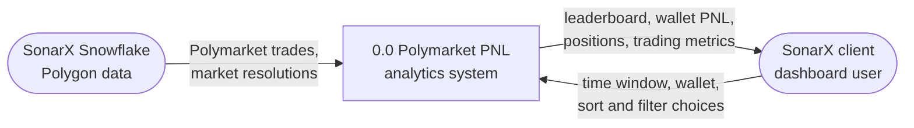
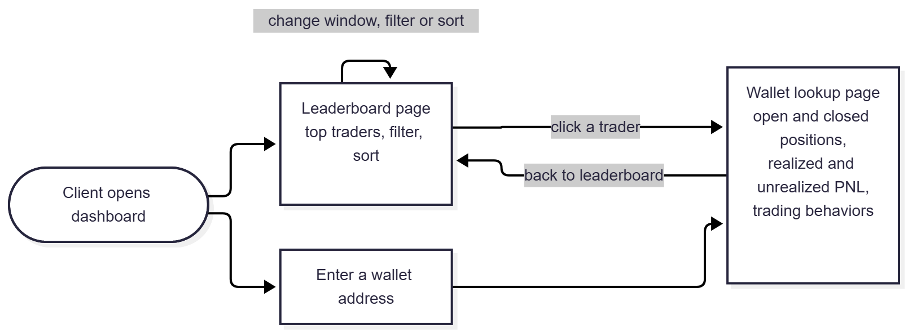

# Project Proposal — Polygon Prediction Market PNL and Trader Profitability Analytics

Department of Computer Science
CPSC 490 Undergraduate Seminar in Computer Science — Proposal for Capstone Project

**Group 04** — Epic Engineers · **Sponsor** — SonarX  
**Authors:** Orozco, Bryan (Bryancostco); Cox, Justin (justincox8); De Belen, Leila (leiladb); Quach, Kyle (kyquach);  
**Proposal Date:** 2026-11-29  

## 0. Abstract  
Polymarket generates large amounts of on-chain trading activity based on real-world events. However, Polymarket’s raw blockchain data is not able to account for profits and losses. In this project, we will use SonarX’s Polygon blockchain data to build a profit and loss (PNL) accounting tool for Polymarket. We will parse on-chain trades, match positions to resolutions, and compute the realized and unrealized PNL for each wallet. We will then rank the top traders and see what drives their edge. The final deliverable will be a working dashboard that showcases these top traders and trading patterns. The sections below will cover the problems, our goals to fix them, the outcome of our project, and our timeline. This project is significant because by doing this we are addressing the issue of raw data not being able to represent profits and losses, as well as discovering the drive behind successful traders. 	

## 1. Introduction  
Polymarket is a real-world events-based prediction market platform where users trade the outcomes of events [1]. This market is not structured as typical gambling because instead of betting against a house, a user will trade contracts with other users, which determines if they profit off of their contracts [1]. The system of Polymarket works off “Yes”, if they think this event will happen, and “No”, if they think it will not [1]. Users profit a dollar for every correct bid minus how much they already paid for the contract, though they lose the money they paid if incorrect [1]. For example if a user thinks an event will happen, they will put in a buy for $0.70. Another user will then sell them the “Yes” for $0.70 for certain reasons, one potentially being because they do not think it will happen. If the first user is correct, they gain $0.30, but lose $0.70 if the event does not happen. Polygon is “a global network of aggregated blockchains” [2]. Polygon is a network that Polymarket is built upon because anyone with internet can participate, users can control their own funds, all activity done is publicly verifiable onchain, and it enables quick, low-cost transactions [3]. Our project will use SonarX's Polygon blockchain data to build a profit and loss accounting tool for Polymarket. We will be creating a dashboard tool that identifies the top traders, and what drives their edge. 

While there are many competitors, our project wants to use a more industrial take on Polymarket, rather than only a bot-trading tool. The projects Polymarket Analytics and Predicts.guru analyze the wallets of top traders [4][5]. When reviewing their sites, it is clear that our project will be achieving the same goal as those that already exist, which is wallet lookup. But, with the websites that are already made, and the raw data from Polymarket, their data will help our PNL tool compute and explain the wallets that already exist to allow users to understand the wallets being traded, the profits and losses that are open and closed, and what drives the successful traders. Our project would be used to help users read the raw trade data easily with our dashboard, allowing users to understand the current state of the wallets and how profits and losses happen to traders in Polymarket. 

One problem we encounter when building this project is that Polymarket’s blockchain data displays a trader’s wallet transactions, but it does not explain how there is profit and loss. The second problem is that our competitors show who is profiting the most, but not the drive behind traders. The importance of solving these problems is that we are able to understand how there is profit and loss, which is better for understanding the ranking of traders. It is also important that we are able to learn what drives traders, as that is the key to discovering their success. Our proposal is different than existing projects because we will be focusing on an industrial standpoint of the Polymarket. Alongside these problems with the data and existing tools we also aim to solve two business problems for SonarX. We want to afford SonarX the ability to visualize Polymarket trader PNL for potential clients. The importance of solving this problem is that not all clients may be technical, so visualizing the data makes it easier for the company to work with potential clients. The final problem we want to address is that competitors of SonarX are creating and institutionalizing similar dashboards, and with the rise of institutional needs for prediction market analytics, it is imperative that SonarX stays competitive. 


### 1.1 Related Work
| Existing approach | What it does | Pros | Cons | Why ours differs |
|---|---|---|---|---|
| Polymarket Analytics  |“Real-time analytics for Polymarket prediction markets. Track whale wallets and insider-sized trades, follow the traders with the best P&L, pull historical price data on any market, and see open interest and volume across every event” [4].  | Has a whale tracker that allows people to see large trades, and allows them to understand its positioning, and detects unusual activity [4]. People can look up other user’s positions and their own portfolio [4]. Market data is updated regularly [4].  | “The data is pulled from third-party APIs and blockchain sources”, meaning data can be delayed or not completely accurate. Tracking the whale wallets does not guarantee users land a successful trade as well [4].   | *Will discover after meeting with mentor  |
| Predicts.guru  | “Predicts.guru provides free wallet analytics based on public Polymarket trading data. Review profit and loss, win rate, markets traded, and open positions” [5]. | Users can use website for free with no sign-up needed [5]. Users can compare wallets side-by-side for easier access [5].  | “Only public Polymarket activity is covered. A trader using several addresses appears as separate wallets, transfers between addresses are not linked, and trading on other venues is out of scope” [5].  | *Will discover after meeting with mentor  |
| Polycopy   | “Mirror traders and strategies on the best copy trading platform for Polymarket” [6].  | No experience is needed, which is useful for first time users of Polymarket [6]. Has bots to make it easier to copy traders, and strategies [6]. Also has paper bots to simulate trade [6].  | If the bot is mirroring a trader that is losing money, the user will also lose money [6]. | *Will discover after meeting with mentor  |
| Polytrackhq.app  | “The #1 Polymarket whale tracker. Follow smart money traders with proven 60%+ win rates. Real-time wallet tracking, P&L analytics, and instant alerts when whales make moves” [7]. | Allows for whale tracking and the ability to mirror traders on the same platform [7]. Users are able to monitor the market  in real time [7]. | Mirroring successful traders does not guarantee users make a profit [7]. Users are dependent on trades of other Polymarket users [7].  | *Will discover after meeting with mentor  |

While there are many competitors, and some recognized in the table above, our project wants to use a more industrial take on Polymarket, rather than only a bot-trading tool. The first two projects in the table analyze the wallets of top traders, while the other competitors focus on users using bot trading. When reviewing the table, it is clear that our project will be achieving the same goal of those that already exist, which is wallet lookup. But, with the websites that are already made, and the raw data from Polymarket, their data will help our PNL tool compute and explain the wallets that already exist to allow users to understand the wallets being traded, the profits and losses that are open and closed, and what drives the successful traders. As projects cited as [4] and [7] in the table above demonstrate, there is a common theme present within their advantages which is they review whale trading, to which our tool would be built to excel in documenting. When reviewing the table of the cons of projects cited [6] and [7], we see that users depend on bots and mirroring. Our project would be used to help users read the raw trade data easily with our dashboard, allowing users to understand the current state of the wallets and how profits and losses happen to traders in Polymarket. 

### 1.2 Problem Statements
| Problem | Addressed by |
|---|---|
| P1 - Polymarket’s blockchain data displays a trader’s wallet transactions, but it does not explain how there is profit and loss. | Goal 1 |
| P2 - Our competitors show who is profiting the most, but not the drive behind traders.  | Goal 2 |
| P3 - SonarX needs to visualize trader PNL for potential clients. | Goal 3 |
| P4 - Competitors of SonarX are building similar dashboards, we want SonarX to stay competitive.  | Goal 1,2,3 |

## 2. Goals and Objectives

We have determined three goals for our project. All relate to the issues discussed in the introduction. Our goals also correspond to the discussion we had at the initial meeting with SonarX. Phase 1 of our project deals with calculating the profit and loss of each proxy wallet using historical data. Phase 2 associates proxy wallets with their owner (EOA) wallets and uses real time data. We will leave Phase 2 as future work. Each goal is listed as an epic in the GitHub repository used by our team, and each objective is listed as a user story in the same repository.

**Goal 1: Compute the profit and loss of each Polymarket proxy wallet** [[epic:#24]](https://github.com/Bryancostco/CPSC490-G04-EpicEngineers/issues/24 "Goal 1: Compute the profit and loss of each Polymarket proxy wallet")

Objective 1.1: Collect all Polymarket market resolutions and trades from SonarX's Polygon blockchain data stored in Snowflake over a historical period agreed upon with SonarX. [[story:#25]](https://github.com/Bryancostco/CPSC490-G04-EpicEngineers/issues/25 "Objective 1.1: Collect all Polymarket market resolutions and trades from SonarX's Polygon blockchain data stored in Snowflake over a historical period agreed upon with SonarX")

Objective 1.2: Associate each wallet's transactions with their market resolution in order to determine whether each position is open or closed. [[story:#26]](https://github.com/Bryancostco/CPSC490-G04-EpicEngineers/issues/26 "Objective 1.2: Associate each wallet's transactions with their market resolution in order to determine whether each position is open or closed")

Objective 1.3: Compute the realized PNL for closed positions and the unrealized PNL for open positions for each proxy wallet. [[story:#27]](https://github.com/Bryancostco/CPSC490-G04-EpicEngineers/issues/27 "Objective 1.3: Compute the realized PNL for closed positions and the unrealized PNL for open positions for each proxy wallet")

Objective 1.4: Test the accuracy of the computed PNL by comparing a sample of at least 25 wallets, including both highly profitable and ordinary wallets, to data from Predicts.guru and Polymarket Analytics and note any discrepancies. [[story:#28]](https://github.com/Bryancostco/CPSC490-G04-EpicEngineers/issues/28 "Objective 1.4: Test the accuracy of the computed PNL by comparing a sample of at least 25 wallets, including both highly profitable and ordinary wallets, to data from Predicts.guru and Polymarket Analytics and note any discrepancies")

**Goal 2: Determine the most profitable traders and the factors that contribute to that profitability** [[epic:#29]](https://github.com/Bryancostco/CPSC490-G04-EpicEngineers/issues/29 "Goal 2: Determine the most profitable traders and the factors that contribute to that profitability")

Objective 2.1: Compute the PNL and return on investment for each proxy wallet and produce a leaderboard of the most profitable traders. [[story:#30]](https://github.com/Bryancostco/CPSC490-G04-EpicEngineers/issues/30 "Objective 2.1: Compute the PNL and return on investment for each proxy wallet and produce a leaderboard of the most profitable traders")

Objective 2.2: Analyze the trading behaviors of each ranked wallet, including win rate, average entry price, market categories traded, and position holding period. [[story:#31]](https://github.com/Bryancostco/CPSC490-G04-EpicEngineers/issues/31 "Objective 2.2: Analyze the trading behaviors of each ranked wallet, including win rate, average entry price, market categories traded, and position holding period")

Objective 2.3: Determine how the top 100 traders differ from the remaining wallets by comparing their trading behaviors to all other wallets, and note at least three observations regarding the differences between profitable and unprofitable traders. [[story:#32]](https://github.com/Bryancostco/CPSC490-G04-EpicEngineers/issues/32 "Objective 2.3: Determine how the top 100 traders differ from the remaining wallets by comparing their trading behaviors to all other wallets, and note at least three observations regarding the differences between profitable and unprofitable traders")

**Goal 3: Create a client-facing dashboard that allows for an easy interpretation of PNL data** [[epic:#33]](https://github.com/Bryancostco/CPSC490-G04-EpicEngineers/issues/33 "Goal 3: Create a client-facing dashboard that allows for an easy interpretation of PNL data")

Objective 3.1: Determine a list of questions that SonarX clients would like answered by the dashboard, and have this list approved by our SonarX mentor, prior to creating any aspect of the dashboard. [[story:#34]](https://github.com/Bryancostco/CPSC490-G04-EpicEngineers/issues/34 "Objective 3.1: Determine a list of questions that SonarX clients would like answered by the dashboard, and have this list approved by our SonarX mentor, prior to creating any aspect of the dashboard")

Objective 3.2: Create a leaderboard page to display the top traders and allow filtering and sorting of these traders. [[story:#35]](https://github.com/Bryancostco/CPSC490-G04-EpicEngineers/issues/35 "Objective 3.2: Create a leaderboard page to display the top traders and allow filtering and sorting of these traders")

Objective 3.3: Create a wallet lookup page to display a wallet's open and closed positions, realized and unrealized PNL, and trading behaviors. [[story:#36]](https://github.com/Bryancostco/CPSC490-G04-EpicEngineers/issues/36 "Objective 3.3: Create a wallet lookup page to display a wallet's open and closed positions, realized and unrealized PNL, and trading behaviors")

Objective 3.4: Create a fast dashboard where all pages load in under 3 seconds on our demo data. [[story:#37]](https://github.com/Bryancostco/CPSC490-G04-EpicEngineers/issues/37 "Objective 3.4: Create a fast dashboard where all pages load in under 3 seconds on our demo data")

Objective 3.5: Show a functional version of our dashboard to SonarX and note their feedback. [[story:#38]](https://github.com/Bryancostco/CPSC490-G04-EpicEngineers/issues/38 "Objective 3.5: Show a functional version of our dashboard to SonarX and note their feedback")

## 3. Proposed Approaches

Deciding on how traders are ranked. We chose to rank traders by both total PNL and return on investment (ROI), rather than only choosing one (Objective 2.1). Total PNL will help show us the amount of profit or loss a trader generates in actual dollars, though it tends to favor the wallets with more capital, rather than the wallets profiting more capital. ROI measures profit relative to the capital invested, percentage wise, but it over-reward small wallets that may have had lucky bets. By using both, on the dashboard we can have clients sort the different traders, by either total PNL or ROI (Objective 3.2), and our dashboard is more detailed with both.

How accuracy is validated. We decided to compare 25+ wallets to Predicts.guru and Polymarket Analytics instead of internal consistency checks only because we can check that our data matches the external sources provided (Objective 1.4). By doing that, our credibility is better because  it is relying on reliable sources. If we were to only do internal consistency checks, it would be great for testing during our development phase, but overall would not be able to match the real-world trading market.

Scope. We will start with historical proxy wallets (Phase 1) rather than starting with linking to owner wallets and use real-time data (Phase 2). This is because for the beginning, we are able to validate wallet rankings, PNL, and ROI before interweaving live data complexity, which will be easier to work with. If we were to link owner wallets and use-real time data, there would be data reliability issues because the real data will be constantly changing, whereas historical proxy wallets allow us to validate our data with external resources like Polymarket Analytics. 

Dashboard. We have decided to agree on client questions with the mentor first (Objective 3.1), rather than build first and adjust later. We already made a document containing questions that the clients would want answered within this dashboard. By choosing to have client questions to frame our dashboard, we can easily work with our mentor on how our project is supposed to look, rather than building a completely different dashboard that we may need to change completely. 

The implementation stack and tooling are detailed in §4.

## 4. Required Environment, Resources, and Planned Activities

Our project will run its queries on Snowflake, which is the main warehouse SonarX uses for its Polygon blockchain data, as confirmed at our kickoff meeting with SonarX. SonarX allows us to use open source tools and libraries. The PNL pipeline is written in Python and runs outside Snowflake: it reads trades and market resolutions through the Snowflake Python connector, and builds positions, FIFO lots and profit and loss in Python using exact decimals, so the worked examples in our specifications become automated tests directly. We chose this over computing PNL in SQL inside Snowflake, where FIFO matching across partial sales is hard to express and to test, and over Python running inside Snowflake, which depends on what SonarX's account allows. Where the computed results are stored and which framework the dashboard uses have not been chosen yet; we will record them in this section once the team decides. [[task:#52]](https://github.com/Bryancostco/CPSC490-G04-EpicEngineers/issues/52 "Record the chosen prototype stack in CLAUDE.md and proposal §4")

### Specification and design documents

Each specification and design document is listed here with the objectives it serves, as it is added to `docs/specs/` or `docs/design/`.

The position matching and PNL specification, [`docs/specs/pnl-calculation.md`](../docs/specs/pnl-calculation.md), defines how trades become positions, how FIFO cost basis works, when a position is open or closed, and the realized and unrealized PNL formulas, with a worked example computed by hand. It serves Objective 1.2 and Objective 1.3. [[task:#55]](https://github.com/Bryancostco/CPSC490-G04-EpicEngineers/issues/55 "Draft docs/specs/pnl-calculation.md (Goal 1 definitions)")

<!-- inline:begin docs/specs/pnl-calculation.md (copied by scripts/inline_docs.py: edit docs/specs/pnl-calculation.md, then rerun the script) -->

### Specification — Position matching and PNL calculation

Epic: #24 · Stories: #26, #27 · Task: #55
Owner: Bryan Orozco · Sprint: 2 · Status: draft

*How the system turns a proxy wallet's Polymarket trades into positions,
decides whether each position is open or closed, and computes realized and
unrealized profit and loss (PNL). The prototype code for #26 and #27 is
tested against this document, and the validation in #28 checks it.*

The two objectives it serves, quoted from proposal §2:

Objective 1.2: Associate each wallet's transactions with their market
resolution in order to determine whether each position is open or closed.

Objective 1.3: Compute the realized PNL for closed positions and the
unrealized PNL for open positions for each proxy wallet.

**Scope**

**In scope.** Proxy wallets only (Phase 1). Trades and market resolutions
from SonarX's Polygon data in Snowflake over the last 12 months, the Phase 1
window our mentor set on Oct 20, 2026
([#20](https://github.com/Bryancostco/CPSC490-G04-EpicEngineers/issues/20#issuecomment-6330393347)).
Grouping trades into positions, FIFO cost basis, open or closed status,
realized PNL, unrealized PNL, and wallet totals.

**Out of scope.** Linking proxy wallets to their owner (EOA) wallets, which is
Phase 2 and future work. Real time data. Ranking, return on investment and
trading behavior metrics, which belong to `docs/specs/trader-ranking.md`
(#54). Which tables and columns hold each field, which belongs to
`docs/specs/data-sources.md` (#25). How the dashboard shows any of this (#33).

***Pipeline steps***

The pipeline has six numbered steps. The data flow diagrams in
`docs/design/data-flow.md` (#58) number their processes the same way
(process 1.0 is step 1), so a process in a diagram and a step here always
mean the same thing.

| Step | Name | Defined in |
|---|---|---|
| 1 | Extract trades and market resolutions | `docs/specs/data-sources.md` (#25) |
| 2 | Build positions and cost basis lots | this document, FR-1 to FR-7 |
| 3 | Match positions to resolutions and set status | this document, FR-8 to FR-10 |
| 4 | Compute realized and unrealized PNL | this document, FR-11 to FR-15 |
| 5 | Rank wallets and compute trading metrics | `docs/specs/trader-ranking.md` (#54) |
| 6 | Serve results to the dashboard | dashboard documents (#33) |

**Definitions**

| Term | Meaning in this project |
|---|---|
| Proxy wallet | The wallet address that holds a Polymarket user's shares and appears on chain as the trader. Phase 1 computes PNL per proxy wallet. |
| EOA | Externally owned account: the owner wallet behind one or more proxy wallets. Phase 2 only. |
| Outcome token | One side of a market, such as YES or NO. Each outcome token is traded separately. |
| Trade | One fill in which a proxy wallet buys or sells shares of one outcome token at one price per share. |
| Position | All of one proxy wallet's shares in one outcome token of one market. |
| Lot | The shares from one buy, with the price per share paid. FIFO consumes lots oldest first. |
| Cost basis | What the shares still held cost, taken from the lots that remain. |
| FIFO cost basis | First in, first out: a sale is matched against the oldest lot first, at the price paid for it (FR-6). |
| Payout per share | What one share of an outcome token is worth once its market resolves, taken from the resolution data. A winning share pays 1.00 and a losing share 0.00 [1]. |
| Latest price | The price of the most recent trade in an outcome token at or before the as of time. |
| As of time (T) | The moment the calculation describes. Everything after T is ignored. |
| Realized PNL | Profit or loss that is locked in, from a sale or from the market resolving. |
| Unrealized PNL | Profit or loss on shares still held in a market that has not resolved, marked at the latest price. |

**Functional requirements**

Written in EARS form ("when a trigger happens, the system shall respond") so each
one becomes a test almost verbatim. FR-6 and FR-7 apply FIFO, the cost basis
our mentor set as the default on Oct 20, 2026
([#20](https://github.com/Bryancostco/CPSC490-G04-EpicEngineers/issues/20#issuecomment-6330393347)).

| ID | Requirement | Story |
|---|---|---|
| FR-1 | When trades are loaded, the system shall group them into one position per proxy wallet, market and outcome token, so a wallet holding both YES and NO in one market has two positions. | #26 |
| FR-2 | When the system processes a position, it shall apply that position's trades in chain order: earlier block first, and within a block, earlier position in the block first. | #26 |
| FR-3 | When a trade is a buy, the system shall add a lot with the shares bought and the price per share paid. | #26 |
| FR-4 | When a trade is a sell, the system shall remove the sold shares from the position's lots under FR-6. | #26 |
| FR-5 | When a sell is for more shares than the position's lots hold, the system shall match only the shares that are held, mark the position as incomplete, and record how many shares were unmatched. | #26 |
| FR-6 | When a sale is matched, the system shall take shares from the oldest remaining lot first, and move to the next oldest lot only when the current one is empty. | #27 |
| FR-7 | When shares from a lot are sold, the system shall add (sale price − lot price) × shares sold from that lot to the position's realized PNL. | #27 |
| FR-8 | When a position's market has a resolution at or before T, the system shall mark the position closed. | #26 |
| FR-9 | When a position's market has no resolution at or before T and its lots hold zero shares, the system shall mark the position closed. | #26 |
| FR-10 | When a position's market has no resolution at or before T and its lots hold more than zero shares, the system shall mark the position open. | #26 |
| FR-11 | When a position's market resolves at or before T, the system shall add (payout per share − lot price) × shares for every lot still held to the position's realized PNL, using the payout per share from the resolution data. | #27 |
| FR-12 | When a position is open, the system shall set its unrealized PNL to the sum over its remaining lots of (latest price − lot price) × shares. | #27 |
| FR-13 | When a position is closed, the system shall set its unrealized PNL to zero. | #27 |
| FR-14 | When wallet totals are requested, the system shall report the sum of realized PNL, the sum of unrealized PNL, and their total, across all of the wallet's positions. | #27 |
| FR-15 | When any position in a wallet is incomplete under FR-5, the system shall flag the wallet's totals as incomplete. | #27 |

FR-5 exists because the window starts 12 months back. A wallet that bought
before the window and sold inside it has no lot to match against, and
inventing a cost for those shares would make its PNL look certain when it is
not.

FR-8 closes a position when its market resolves, whether or not the wallet
has redeemed its winning shares yet. Redemption turns shares into cash; it
does not change what the position earned. Polymarket describes winning
shares as redeemable for 1.00 each once the outcome is final [1].

***PNL formulas***

For a position, with lots *i* still held after all sales:

```
realized PNL   = Σ over sales  (sale price − lot price) × shares taken from that lot
               + Σ over lots i (payout per share − price_i) × shares_i      if resolved by T
unrealized PNL = Σ over lots i (latest price − price_i) × shares_i          if open at T
               = 0                                                          if closed at T
total PNL      = realized PNL + unrealized PNL
```

Unrealized PNL is marked at the latest market price, as our mentor set
([#20](https://github.com/Bryancostco/CPSC490-G04-EpicEngineers/issues/20#issuecomment-6330393347)).

***Worked example, computed by hand***

A made up proxy wallet **W** with two positions. Prices are per share.

**Position A: W holds YES in market M1.**

| Time | Trade | Shares | Price | Lots after the trade |
|---|---|---|---|---|
| t1 | buy | 100 | 0.40 | L1: 100 @ 0.40 |
| t2 | buy | 50 | 0.60 | L1: 100 @ 0.40, L2: 50 @ 0.60 |
| t3 | sell | 120 | 0.70 | L2: 30 @ 0.60 |

The sale at t3 takes all 100 shares of L1, then 20 shares of L2 (FR-6):

| From | Shares | Calculation | Realized |
|---|---|---|---|
| L1 | 100 | (0.70 − 0.40) × 100 | 30.00 |
| L2 | 20 | (0.70 − 0.60) × 20 | 2.00 |
| **Sale total** | 120 | | **32.00** |

The cost basis method changes the answer: an average cost method prices all
150 shares at 70.00 ÷ 150 = 0.4667, so the same sale would realize
(0.70 − 0.4667) × 120 = 28.00 instead of 32.00.

What happens next depends on M1 at the as of time T:

| Case at T | Status | Realized | Unrealized | Total |
|---|---|---|---|---|
| M1 unresolved, latest YES price 0.55 | open (FR-10) | 32.00 | (0.55 − 0.60) × 30 = −1.50 | 30.50 |
| M1 resolved YES, payout 1.00 | closed (FR-8) | 32.00 + (1.00 − 0.60) × 30 = 44.00 | 0.00 | 44.00 |

Cash check for the resolved case: W paid 40.00 + 30.00 = 70.00, received
84.00 from the sale and 30 × 1.00 = 30.00 at resolution, so it ends 44.00
ahead, which matches.

**Position B: W holds NO in market M2.** W buys 200 NO shares at 0.25 (cost
50.00). M2 resolves YES, so NO pays 0.00: realized PNL is
(0.00 − 0.25) × 200 = −50.00, unrealized is 0.00, and the position is closed.

**Wallet W totals (FR-14):**

| Case for M1 | Realized | Unrealized | Total |
|---|---|---|---|
| M1 unresolved | 32.00 − 50.00 = −18.00 | −1.50 | −19.50 |
| M1 resolved YES | 44.00 − 50.00 = −6.00 | 0.00 | −6.00 |

**Non-functional requirements**

| ID | Requirement | Why it matters here |
|---|---|---|
| NFR-1 | Running the calculation twice on the same trades, resolutions and T gives identical results. | #25 asks a teammate to rerun our work and match it, and #28 compares our numbers against outside sources; neither works if results drift. |
| NFR-2 | Prices, shares and PNL are held as exact decimals, never binary floating point, and are rounded only when displayed. | PNL sums thousands of small differences such as 0.70 − 0.60; floating point error adds up across a 12 month window. |
| NFR-3 | Every realized or unrealized figure can be traced back to the trades and lots that produced it. | #28 must explain any discrepancy with an outside source, which means showing the trades behind a number. |

**Acceptance criteria (epic level)**

- [ ] The prototype reproduces the worked example exactly, as tests that
      each fail if FR-6, FR-7, FR-8, FR-10, FR-11 or FR-12 is removed.
- [ ] A position with a sell larger than its lots is marked incomplete
      (FR-5), with a test.
- [ ] Every functional requirement cites #26 or #27, and every open
      question below has an owner.
- [ ] This document is listed in proposal §4 under Specification and design
      documents.

**Open questions**

| Question | Owner | Needed by |
|---|---|---|
| Q1. Should positions marked incomplete (FR-5) be left out of the leaderboard, shown with a warning, or fixed by loading earlier trades for those wallets only? (ask Erel) | Bryan Orozco | before ranking work in #30 |
| Q2. Do SonarX's Polymarket tables record trading fees per trade? If they do, realized PNL subtracts them; if not, we report PNL before fees and say so. (ask Sergio) | Bryan Orozco | before #27 is implemented |
| Q3. Which table and column give the latest price for an outcome token, and how fresh is it? (ask Sergio) | Bryan Orozco | before #27 is implemented |
| Q4. Besides buys and sells, which events change a wallet's shares in the data (for example splitting collateral into a YES and NO pair, merging a pair back, redeeming after resolution, or transfers between wallets), and how does each appear? Each needs its own requirement before #26 is built. (ask Sergio) | Bryan Orozco | before #26 is implemented |
| Q5. Can a market resolve with a payout per share other than 1.00 or 0.00? FR-11 already reads the payout from the data, so this only changes the test cases. (ask Sergio) | Bryan Orozco | before #27 tests |
| Q6. What tolerance between our PNL and the Polymarket leaderboard counts as a match? Our mentor said to set it together after a first pass. (ask Erel) | Bryan Orozco | before #28 |

**Sources**

[1] Polymarket. Polymarket 101. Polymarket Documentation.
https://docs.polymarket.com/polymarket-101 (accessed Oct. 24, 2026).

<!-- inline:end docs/specs/pnl-calculation.md -->

The trader ranking and behavior specification, [`docs/specs/trader-ranking.md`](../docs/specs/trader-ranking.md), defines how proxy wallets are ranked by total PNL and by return on investment (including the minimum activity rule and the tie breaks), and how win rate, average entry price, market categories traded, and position holding period are calculated, with a worked example computed by hand. It serves Objective 2.1 and Objective 2.2. [[task:#54]](https://github.com/Bryancostco/CPSC490-G04-EpicEngineers/issues/54 "Draft docs/specs/trader-ranking.md (Goal 2 definitions)")

<!-- inline:begin docs/specs/trader-ranking.md (copied by scripts/inline_docs.py: edit docs/specs/trader-ranking.md, then rerun the script) -->

### Specification — Trader ranking and trading behavior metrics

Epic: #29 · Stories: #30, #31 · Task: #54
Owner: Justin Cox · Sprint: 2 · Status: draft

*How the system ranks proxy wallets by profitability and describes how each
ranked wallet trades. It takes the per position results of the position
matching and PNL specification (#55, "the position spec") and turns them into
two rankings (#30) and four trading behavior metrics (#31). The prototype
code for #30 and #31 is tested against this document, and the validation in
#28 checks it. The rules and definitions here are written by the team for this
project; they are not copied from an outside standard.*

The two objectives it serves, quoted from proposal §2:

Objective 2.1: Compute the PNL and return on investment for each proxy
wallet and produce a leaderboard of the most profitable traders.

Objective 2.2: Analyze the trading behaviors of each ranked wallet,
including win rate, average entry price, market categories traded, and
position holding period.

**Scope**

**In scope.** Proxy wallets only (Phase 1). The same 12 month window as the
position spec, set by our mentor on Oct 20, 2026
([#20](https://github.com/Bryancostco/CPSC490-G04-EpicEngineers/issues/20#issuecomment-6330393347)).
Wallet total PNL, return on investment (ROI), the minimum activity rule, two
rankings (one by total PNL and one by ROI) with a written tie break for each,
and the four metrics: win rate, average entry price, market categories
traded, and position holding period.

**Out of scope.** How positions, lots and PNL are computed, which belongs to
the position spec (#55). Linking proxy wallets to their owner (EOA) wallets,
which is Phase 2 and future work. Real time data. Which tables and columns
hold each field, which belongs to `docs/specs/data-sources.md` (#25). How the
dashboard shows the rankings or the metrics (#33).

***Pipeline steps***

This document defines step 5. The numbering is the one used in the position
spec and in the data flow diagrams in `docs/design/data-flow.md` (#58): a
process in a diagram and a step here always mean the same thing.

| Step | Name | Defined in |
|---|---|---|
| 1 | Extract trades and market resolutions | `docs/specs/data-sources.md` (#25) |
| 2 | Build positions and cost basis lots | position spec (#55), FR-1 to FR-7 |
| 3 | Match positions to resolutions and set status | position spec (#55), FR-8 to FR-10 |
| 4 | Compute realized and unrealized PNL | position spec (#55), FR-11 to FR-15 |
| 5 | Rank wallets and compute trading metrics | this document, FR-1 to FR-18 |
| 6 | Serve results to the dashboard | dashboard documents (#33) |

Step 5 reads only the output of step 4 (each position's status, realized PNL,
unrealized PNL and incomplete flag) plus the trades behind it. It does not
recompute PNL.

**Definitions**

Terms the position spec already defines (proxy wallet, outcome token, trade,
position, lot, closed and open, as of time T, realized PNL, unrealized PNL)
keep the same meaning here. The terms below are new.

| Term | Meaning in this project |
|---|---|
| Incomplete position | A position flagged under position spec FR-5: it sold more shares than its lots held, so part of its PNL could not be matched. |
| Incomplete wallet | A wallet flagged under position spec FR-15: at least one of its positions is incomplete. |
| Window | The 12 month period ending at T. Only trades inside it are used. |
| Total PNL | A wallet's realized PNL plus its unrealized PNL, summed across all its positions. |
| Total amount spent | What the wallet spent on every buy in the window: Σ shares × price per share. It counts buys whose shares were later sold or are still held. |
| Return on investment (ROI) | Total PNL divided by total amount spent. |
| PNL ranking | All wallets ordered by total PNL, highest first (FR-4, FR-5). |
| ROI ranking | Eligible wallets ordered by ROI, highest first (FR-7, FR-8). |
| Eligible wallet | A wallet that meets every threshold of the minimum activity rule (FR-6). Only eligible wallets appear in the ROI ranking. |
| Ranked wallet | A wallet in the top N of the PNL ranking or the ROI ranking. The metrics are computed for every ranked wallet (FR-11). |
| Winning position | A closed position whose realized PNL is greater than zero. |
| Entry price | The price per share paid on a buy. Every share is priced between 0.00 and 1.00, and the price reflects the market's belief in the probability of that outcome [1]. |
| Category | The label that groups markets by topic, taken from the market data (Q3 asks where it comes from). |
| Holding period | The time from a position's first buy to the moment it closes, in days. |

***Minimum activity thresholds***

Starting values, kept in configuration and printed with every ranking
(FR-9). Q2 asks our mentor to confirm them.

| Threshold | Starting value |
|---|---|
| Distinct markets traded in the window | at least 10 |
| Trades (buys and sells) in the window | at least 30 |
| Total amount spent | at least 1,000 USD |
| Ranking size N (each ranking) | 100 |

**Functional requirements**

Written in EARS form ("when a trigger happens, the system shall respond") so each
one becomes a test almost verbatim. FR-1 to FR-10 serve #30 and FR-11 to FR-18
serve #31.

| ID | Requirement | Story |
|---|---|---|
| FR-1 | When the ranking runs for as of time T, the system shall set each wallet's total PNL to the sum of realized PNL and unrealized PNL across all of the wallet's positions, as computed by the position spec. | #30 |
| FR-2 | When the ranking runs, the system shall set each wallet's total amount spent to the sum of shares × price per share over every buy by the wallet in the window. | #30 |
| FR-3 | When a wallet's total amount spent is greater than zero, the system shall set its ROI to total PNL ÷ total amount spent; when it is zero, the system shall leave ROI empty. | #30 |
| FR-4 | When the PNL ranking is built, the system shall order all wallets by total PNL from highest to lowest, so rank 1 is the highest total PNL and wallets with negative total PNL rank below all wallets with positive total PNL. | #30 |
| FR-5 | When two wallets have the same total PNL, compared to the cent (0.01 USD), the system shall order them by higher ROI (a wallet with empty ROI after one with a value), then higher total amount spent, then earlier first trade in the window, then lower wallet address in alphabetical order, so every wallet gets a distinct rank. | #30 |
| FR-6 | When the ROI ranking is built, the system shall leave out any wallet that has fewer than the threshold number of distinct markets, trades or total amount spent. The PNL ranking is not filtered by this rule. | #30 |
| FR-7 | When the ROI ranking is built, the system shall order the eligible wallets by ROI from highest to lowest. | #30 |
| FR-8 | When two eligible wallets have the same ROI, compared to four decimal places (0.01 percentage points), the system shall order them by higher total PNL, then higher total amount spent, then earlier first trade in the window, then lower wallet address in alphabetical order, so every wallet gets a distinct rank. | #30 |
| FR-9 | When the ranking runs, the system shall return the top N wallets of each ranking and print the thresholds and N used. | #30 |
| FR-10 | When a wallet is incomplete, the system shall carry the incomplete flag onto its row in every ranking it appears in. | #30 |
| FR-11 | When the metrics run, the system shall output win rate, average entry price, market categories traded and holding period for every ranked wallet. | #31 |
| FR-12 | When the win rate of a wallet is requested, the system shall report the number of winning positions divided by the number of closed positions that are not incomplete. | #31 |
| FR-13 | When a position is open or incomplete, the system shall leave it out of the win rate and the holding period statistics, and report the number of open positions and the number of incomplete positions for the wallet. | #31 |
| FR-14 | When the average entry price of a wallet is requested, the system shall report Σ (shares × price per share) ÷ Σ shares over every buy by the wallet in the window, ignoring sells. | #31 |
| FR-15 | When the market categories of a wallet are requested, the system shall report each category traded, the share of the wallet's total amount spent in that category, the total PNL in that category, and the primary category (the one with the largest share of total amount spent). A market with no category is reported as `Uncategorized`. | #31 |
| FR-16 | When the holding period of a wallet is requested, the system shall set each closed position's holding period to its close time minus its first buy time, where the close time is the time of the trade that took the lots to zero shares or, if the market resolved first, the resolution time, and report the average (mean) and the median over those positions in days. | #31 |
| FR-17 | When an open position is reported, the system shall report its age as T minus its first buy time, separately from the holding period of closed positions. | #31 |
| FR-18 | When a metric has nothing to divide or average (no closed positions, or no buys), the system shall report it as empty, never as zero. | #31 |

FR-6 exists so that one lucky bet on a nearly empty wallet cannot take the top
of the ROI ranking: ROI is a ratio, and a ratio over a tiny amount spent is
easy to inflate. Total PNL is a dollar amount, so FR-4 leaves the PNL ranking
unfiltered; Q2 asks whether that is right. FR-13 leaves incomplete positions
out of the win rate and the holding period because their PNL and first buy
time are partly unknown when the window starts after the wallet began
trading, the same reason position spec FR-5 flags them. Q1 asks whether
incomplete wallets should be ranked at all.

FR-14 always gives a number between 0 and 1, because every share is priced
between 0.00 and 1.00 and the price reflects the market's belief in the
probability of the outcome [1]. Read that way, it is the average probability
the market gave the outcomes the wallet bought, weighted by shares.

FR-18 matters because an empty win rate and a 0% win rate say different
things: the first means no evidence, the second means every closed position
lost.

***Formulas***

For a wallet, over the window ending at T:

```
total PNL          = Σ over positions (realized PNL + unrealized PNL)
total amount spent = Σ over buys (shares × price per share)
ROI                = total PNL ÷ total amount spent                 if total amount spent > 0

win rate           = winning positions ÷ closed positions that are not incomplete
avg entry price    = Σ over buys (shares × price) ÷ Σ over buys (shares)
category share     = amount spent in category ÷ total amount spent
holding period     = close time − first buy time                    per closed position
```

Ranking orders:

```
PNL ranking (all wallets)          ROI ranking (eligible wallets only)
1. total PNL, highest first        1. ROI, highest first
2. ROI, highest first              2. total PNL, highest first
3. total amount spent, highest     3. total amount spent, highest
4. first trade, earliest first     4. first trade, earliest first
5. wallet address, alphabetical    5. wallet address, alphabetical
```

***Worked example, computed by hand***

**Ranking.** Five made up wallets at the same T, with the starting thresholds.
Wallet W is the one from the position spec's worked example, where M1 has
resolved YES (total PNL −6.00, total amount spent 70.00 + 50.00 = 120.00,
4 trades in 2 markets).

| Wallet | Markets | Trades | Total amount spent | Total PNL | ROI | PNL rank | Eligible | ROI rank |
|---|---|---|---|---|---|---|---|---|
| X | 12 | 40 | 5,000.00 | 1,000.00 | 20.0% | 2 | yes | 2 |
| Y | 15 | 60 | 2,000.00 | 1,000.00 | 50.0% | 1 | yes | 1 |
| Z | 3 | 8 | 400.00 | 900.00 | 225.0% | 3 | no | none |
| W | 2 | 4 | 120.00 | −6.00 | −5.0% | 4 | no | none |
| V | 20 | 100 | 8,000.00 | −200.00 | −2.5% | 5 | yes | 3 |

- X and Y tie on total PNL at 1,000.00. FR-5 breaks the tie on ROI:
  Y at 1,000 ÷ 2,000 = 50.0% beats X at 1,000 ÷ 5,000 = 20.0%.
- Z has the highest ROI of all five, but fails all three thresholds
  (3 < 10 markets, 8 < 30 trades, 400 < 1,000 spent), so FR-6 keeps it out of
  the ROI ranking. It still ranks 3rd on total PNL, because FR-4 is not
  filtered. W fails the same way.
- W, at −6.00, ranks above V at −200.00 on total PNL, because a smaller loss
  is a higher number.

**Metrics for wallet W.** From the position spec: position A is YES in M1
(buys 100 @ 0.40 and 50 @ 0.60, then a sale of 120 @ 0.70), and position B is
NO in M2 (buy 200 @ 0.25, M2 resolves YES). Added for this example, both
made up: M1 is in category Politics and M2 in Crypto; A's first buy is on
2026-01-10 and M1 resolves 2026-03-01; B's buy is on 2026-02-01 and M2
resolves 2026-02-21; T is 2026-04-01.

| Metric | Calculation | Result |
|---|---|---|
| Total amount spent | (100 × 0.40) + (50 × 0.60) + (200 × 0.25) = 40 + 30 + 50 | 120.00 |
| Total PNL (M1 resolved) | 44.00 + (−50.00) | −6.00 |
| ROI | −6.00 ÷ 120.00 | −5.0% |
| Win rate | A wins (44.00 > 0), B loses (−50.00); 1 ÷ 2 | 50% |
| Average entry price | 120.00 ÷ (100 + 50 + 200) = 120 ÷ 350 | 0.3429 |
| Category share of total amount spent | Politics 70 ÷ 120, Crypto 50 ÷ 120 | 58.3%, 41.7% |
| PNL by category | Politics 44.00, Crypto −50.00 | primary: Politics |
| Holding period | A: 2026-01-10 to 2026-03-01 = 50 days; B: 2026-02-01 to 2026-02-21 = 20 days | average 35, median 35 days |

Cash check on the average entry price: the three buys cost 120.00 for 350
shares, and 120 ÷ 350 = 0.342857, which rounds to 0.3429.

If M1 had not resolved by T (latest YES price 0.55), A would be open
(position spec FR-10) and the metrics change as follows:

| Metric | Result | Why |
|---|---|---|
| Total PNL | −19.50 | 32.00 − 1.50 − 50.00 |
| ROI | −16.25% | −19.50 ÷ 120.00 |
| Win rate | 0% (0 of 1) | A is open and leaves the win rate (FR-13); only B counts, and it lost |
| Holding period | average 20, median 20 days | only B counts (FR-13) |
| Open positions | 1 | A, reported separately with its age at T (FR-17) |
| Average entry price | 0.3429 | unchanged: it uses buys only (FR-14) |

**Non-functional requirements**

| ID | Requirement | Why it matters here |
|---|---|---|
| NFR-1 | Running the ranking twice on the same positions, trades and T gives the same ranks in the same order. | The tie breaks in FR-5 and FR-8 go down to the wallet address so no ties are left to chance; #28 compares our rankings against outside sources and a shifting order would hide real differences. |
| NFR-2 | PNL, shares, prices and ratios are held as exact decimals, never binary floating point, and are rounded only when displayed and for the tie comparisons in FR-5 and FR-8. | ROI and win rate are divisions of sums; rounding early can swap two close wallets. |
| NFR-3 | Every ranking row and metric can be traced back to the positions and trades that produced it. | #28 must explain any gap with an outside leaderboard, which means showing the positions behind a rank. |
| NFR-4 | Every ranking output states the as of time, the window, the thresholds and N it was run with. | A ranking cannot be compared or rerun without them. |

**Acceptance criteria (epic level)**

- [ ] The prototype reproduces both worked examples exactly, as tests that
      each fail if FR-3, FR-4, FR-5, FR-6, FR-7, FR-8, FR-12, FR-13, FR-14,
      FR-15 or FR-16 is removed.
- [ ] A wallet below any one threshold is left out of the ROI ranking but
      still appears in the PNL ranking, with a test (wallet Z).
- [ ] Running the ranking twice on the same data gives the same order in both
      rankings, with a test (NFR-1).
- [ ] A metric with nothing to divide is reported as empty rather than zero
      (FR-18), with a test.
- [ ] The metrics for at least 3 wallets match a hand calculation by a
      teammate who did not write the code.
- [ ] Every functional requirement cites #30 or #31, and every open question
      below has an owner.
- [ ] This document is listed in proposal §4 under Specification and design
      documents.

**Open questions**

| Question | Owner | Needed by |
|---|---|---|
| Q1. Should incomplete wallets (position spec Q1) be left out of the rankings, ranked with a warning, or ranked only after earlier trades are loaded for them? FR-10 only carries the flag for now. (ask Erel) | TBD | before ranking work in #30 |
| Q2. Are the starting thresholds (10 markets, 30 trades, 1,000 USD) and N = 100 right for the data we have? Should the minimum activity rule also apply to the PNL ranking? #30 names only the ROI ranking, so this draft leaves the PNL ranking unfiltered. (ask Erel) | TBD | before #30 is implemented |
| Q3. Which table and column give a market's category, does a market ever have more than one, and which one counts if so? FR-15 assumes one category per market. (ask Sergio) | TBD | before #31 is implemented |
| Q4. Should holding period be measured per position (first buy to close, as in FR-16) or per lot under FIFO? A wallet that keeps adding to a position gets a longer period per position than per lot. (ask Erel) | TBD | before #31 tests |
| Q5. Which wallets are "ranked wallets" for #31? FR-11 uses the top N of either ranking; the alternative is the PNL ranking only. (ask Erel) | TBD | before #31 is implemented |
| Q6. If SonarX has no trading fees (position spec Q2), total PNL and ROI are before fees. Do we say that on the rankings themselves or only in this document? (ask Sergio) | TBD | before #33 |
| Q7. Polymarket's documentation says trades use pUSD as collateral [1]. Which collateral token do trades in our 12 month window use, and can its amounts be treated as dollars one for one? This document writes amounts in USD. (ask Sergio) | TBD | before #30 is implemented |

**Sources**

[1] Polymarket. Polymarket 101. Polymarket Documentation.
https://docs.polymarket.com/polymarket-101 (accessed Oct. 26, 2026).

<!-- inline:end docs/specs/trader-ranking.md -->

The dashboard question list, [`docs/specs/dashboard-questions.md`](../docs/specs/dashboard-questions.md), holds the questions SonarX clients want the dashboard to answer, the data behind each one, and the page that answers it. It serves Objective 3.1. [[task:#123]](https://github.com/Bryancostco/CPSC490-G04-EpicEngineers/issues/123 "Draft docs/specs/dashboard-questions.md from Erel's starting client questions")

<!-- inline:begin docs/specs/dashboard-questions.md (copied by scripts/inline_docs.py: edit docs/specs/dashboard-questions.md, then rerun the script) -->

### Dashboard Questions (Objective 3.1, #34)

**Status:** Draft, awaiting mentor approval
**Parent:** Goal 3 (#33)
**Related:** Performance requirement in #37

**1. Purpose**

This document lists the questions clients want the PNL dashboard to answer. For each question it names the data that answers it and the dashboard page that presents it. No interface design is merged until the mentor has approved this list (see Section 6).

**2. Dashboard pages**

| Page | Purpose |
|------|---------|
| **P1. Trader Leaderboard** | Rank wallets by PNL over a selectable time window |
| **P2. Trader Profile** | Drill-down on a single wallet: PNL history, positions, trades |
| **P3. Markets & Strategies** | Break down returns by market, category, and strategy |
| **P4. Early Movers** | Identify wallets that are consistently early on winning outcomes |

**3. Client questions**

Source column: **Mentor** = from mentor guidance (#20), **Proposed** = added by the team for mentor review.

| ID | Question | Data that answers it | Page | Source |
|----|----------|----------------------|------|--------|
| Q1 | Who are the most profitable traders over a given window? | Per-wallet realized PNL, unrealized PNL, total PNL, return on investment (ROI), and win rate (share of closed positions that were profitable), aggregated over the selected date range; trade timestamps | P1 | Mentor |
| Q2 | What markets and strategies drive their returns? | Per-wallet PNL grouped by market, market category, and strategy label; position sizes and holding periods | P3 (linked from P2) | Mentor |
| Q3 | Which wallets are consistently early on winning outcomes? | Entry timestamp and entry price per position vs. market open, price path, and resolution time; resolved outcome per position | P4 | Mentor |
| Q4 | How consistent is a trader's profitability, or is it driven by a few big wins? | Per-position PNL distribution, win rate, PNL by period, largest-win share of total PNL | P2 | Proposed |
| Q5 | How much capital does a trader deploy, and what return do they earn on it? | Position sizes, capital at risk over time, PNL divided by capital deployed | P1, P2 | Proposed |
| Q6 | How does a trader's PNL change over time? | Cumulative realized and unrealized PNL time series per wallet | P2 | Proposed |
| Q7 | What is a trader currently holding, and how much is unrealized? | Open positions, current mark price, unrealized PNL, linked market resolution date | P2 | Proposed |
| Q8 | Which markets or categories are the most profitable for traders overall? | PNL and volume aggregated across all wallets by market and category | P3 | Proposed |

**4. Definitions to settle with the mentor**

These affect how questions are answered, so they need a decision before design starts.

1. **Profitable.** Ranked by total PNL, realized-only PNL, or return on capital? Is there a minimum trade count or volume so tiny wallets do not top the board?
2. **Early (Q3).** Measured as time before resolution, time since market open, or price moved in the trader's favor after entry? What threshold counts as "consistently"?
3. **Strategy (Q2).** Which labels do we derive from on-chain data (for example holding period, market category, position sizing, or buying the favorite vs. the underdog)?
4. **Time windows.** Which presets (7d, 30d, 90d, all-time) plus custom range?
5. **Unrealized PNL.** What mark price do we use for open positions?

**5. Non-functional requirement**

Main views (P1 to P4) should load within a few seconds, per mentor guidance and #37. Questions that require heavy aggregation (Q1, Q3) may need precomputed tables. Confirm the specific target in #37.

**6. Approval**

The mentor approves this finished list before any interface design is merged.

- [ ] Mentor approved
- **Approver:** Erel Saul
- **Date:**
- **Evidence:** (link to meeting notes or PR/issue comment)

**7. Change log**

| Date | Change | Author |
|------|--------|--------|
| October 26, 2026 | Initial draft | Leila De Belen |
| November 5, 2026 | Erel Saul approved questions (#124) | Leila De Belen |

<!-- inline:end docs/specs/dashboard-questions.md -->

The architecture design, [`docs/design/architecture.md`](../docs/design/architecture.md), holds the high level architecture diagram and the system context diagram: SonarX's Snowflake data feeds the analysis, the analysis produces results, and the dashboard shows those results to its user. It serves Objectives 1.1, 2.1 and 3.2. [[task:#56]](https://github.com/Bryancostco/CPSC490-G04-EpicEngineers/issues/56 "Write docs/design/architecture.md with high level architecture and system context diagrams")

<!-- inline:begin docs/design/architecture.md (copied by scripts/inline_docs.py: edit docs/design/architecture.md, then rerun the script) -->

Epic: #24, #29, #33 · Stories: Writing Documentation for Architecture

\
*Figure 1 — System context (left) and high level architecture (right). Editable source: [`architecture.mmd`](../docs/design/diagrams/architecture.mmd).*

<!-- inline:end docs/design/architecture.md -->

The prototype implementation and module diagram, [`docs/design/implementation.md`](../docs/design/implementation.md), displays how our prototype directory is structured, credential configuration, security, proposed structure for setup and testing, and proposed build order. It serves Objective 1.1. [[task:#61]](https://github.com/Bryancostco/CPSC490-G04-EpicEngineers/issues/61 "Write docs/design/implementation.md (module layout, configuration, build order)")

<!-- inline:begin docs/design/implementation.md (copied by scripts/inline_docs.py: edit docs/design/implementation.md, then rerun the script) -->

Epic: #24, #29, #33 · Stories: Implemtation Plan + Mermaid Diagram

### Prototype Structure, Setup, and Implementation Plan

**1. Purpose**

The `prototype/` directory will contain the initial working implementation of EpicEngineers. It will provide a small, testable environment for validating the selected application stack, connecting to Snowflake, and demonstrating the core workflow before expanding into a complete application.

**Dependency:** Implementation is blocked on the technology stack decision in [Issue #52](https://github.com/Bryancostco/CPSC490-G04-EpicEngineers/issues/52). The folder structure below is a proposed baseline. Framework-specific dependencies, commands, and configuration must be finalized after that decision.

**2. Proposed Directory Structure**

```text
prototype/
├── README.md
├── .env.example
├── .gitignore
├── config/
│   └── README.md
├── src/
│   ├── app/
│   │   └── README.md
│   ├── services/
│   │   └── README.md
│   ├── database/
│   │   └── README.md
│   └── config/
│       └── README.md
├── tests/
│   ├── unit/
│   ├── integration/
│   └── fixtures/

```

The exact filenames and source directories may change based on the decision in Issue #52.

***Directory responsibilities***

- **`README.md`** — Documents prerequisites, environment setup, running the prototype, troubleshooting, and the implementation sequence.
- **`.env.example`** — Lists required environment variable names and safe placeholder values. It must never contain actual credentials.
- **`.gitignore`** — Prevents local environment files, secrets, virtual environments, dependency artifacts, caches, and generated files from being committed.
- **`config/`** — Holds non-secret configuration documentation and configuration examples.
- **`src/app/`** — Contains application entry points and the primary application workflow.
- **`src/services/`** — Contains reusable business logic and operations independent of the user interface.
- **`src/database/`** — Contains Snowflake connection handling and data-access logic, including queries or repository functions.
- **`src/config/`** — Loads and validates environment variables and exposes application configuration.
- **`tests/unit/`** — Tests individual functions and modules without requiring a live Snowflake connection.
- **`tests/integration/`** — Tests interactions between components and, when credentials and access are available, Snowflake connectivity and queries.
- **`tests/fixtures/`** — Contains synthetic test data and other non-sensitive test fixtures.
- **`docs/architecture.md`** — Records architectural decisions, component responsibilities, data flow, and known limitations.

Do not create unnecessary abstraction layers before the stack and initial requirements are confirmed. Keep the first working version small.

**3. Configuration and Secret Management**

***Security requirement***

**Snowflake passwords must always be supplied through environment variables. Never hardcode passwords, commit them to the repository, or include them in logs, screenshots, error messages, or documentation.**

The prototype must fail safely when required configuration is missing instead of silently using credentials embedded in source code.

***Environment variables***

The following names are proposed; confirm the required connection parameters against the selected Snowflake connector.

| Variable | Purpose |
|---|---|
| `SNOWFLAKE_ACCOUNT` | Snowflake account identifier |
| `SNOWFLAKE_USER` | Snowflake username |
| `SNOWFLAKE_PASSWORD` | Snowflake password |
| `SNOWFLAKE_WAREHOUSE` | Warehouse used for queries |
| `SNOWFLAKE_DATABASE` | Target database |
| `SNOWFLAKE_SCHEMA` | Target schema |
| `SNOWFLAKE_ROLE` | Role used by the connection, if required |

***Local setup***

1. Install the runtime and dependency manager required by the selected stack.
2. Copy `.env.example` to a local `.env` file, if the chosen framework supports this workflow.
3. Enter the required configuration values locally. Obtain credentials through the team's approved secret-sharing process.
4. Verify that `.env` is ignored by Git before entering any secrets.
5. Install the project's dependencies using the commands documented for the selected stack.
6. Run configuration validation and unit tests before attempting a database connection.

The `.env.example` file should contain only placeholder values, for example:

```dotenv
SNOWFLAKE_ACCOUNT=your_account_identifier
SNOWFLAKE_USER=your_username
SNOWFLAKE_PASSWORD=
SNOWFLAKE_WAREHOUSE=your_warehouse
SNOWFLAKE_DATABASE=your_database
SNOWFLAKE_SCHEMA=your_schema
SNOWFLAKE_ROLE=your_role
```

The real `.env` file must remain local and untracked. If the selected deployment environment provides a secret manager or injects environment variables directly, use that mechanism instead of requiring a `.env` file.

***Required Git protections***

The `.gitignore` file should include at least:

```gitignore
# Secrets and local configuration
.env
.env.*
!.env.example

# Runtime artifacts
__pycache__/
*.py[cod]
.venv/
venv/
node_modules/
dist/
build/
coverage/
.pytest_cache/
```

Adjust these patterns for the selected stack and any existing repository conventions. Before committing, inspect staged changes and verify that no credentials or sensitive configuration files are included.

**4. How to Run the Prototype**

The exact commands are intentionally deferred until Issue #52 establishes the stack.

Once the decision is finalized, the `prototype/README.md` must provide a verified sequence covering:

1. **Prerequisites:** Supported runtime version, dependency manager, and any required external accounts or permissions.
2. **Installation:** Exact commands to install dependencies from the prototype directory.
3. **Configuration:** How to supply environment variables and validate required settings.
4. **Local execution:** The exact command to launch the application and the local URL or CLI invocation, as applicable.
5. **Testing:** Commands for unit tests and integration tests, with clear instructions for tests requiring Snowflake access.
6. **Troubleshooting:** Common setup failures, missing environment variables, authentication errors, and connectivity or permission issues.

The first run should support a local smoke test without requiring live Snowflake credentials wherever practical. Database-dependent tests must clearly identify their prerequisites and must not run destructive operations against shared data.

**5. Implementation Order**

Build the prototype incrementally, validating each stage before moving on.

***Phase 1 — Resolve the stack decision***

- Resolve [Issue #52](https://github.com/Bryancostco/CPSC490-G04-EpicEngineers/issues/52).
- Confirm the language, framework, dependency manager, Snowflake connector, and execution environment.
- Record the selected stack and rationale.
- Finalize the directory structure and runnable setup instructions.

**Exit criterion:** The team agrees on the stack and can document a reproducible development environment.

***Phase 2 — Establish the project foundation***

- Create the prototype directory and essential files.
- Add dependency and runtime configuration.
- Add `.gitignore` and `.env.example`.
- Implement environment-variable loading and validation.
- Add a minimal application entry point and a basic unit-test setup.

**Exit criterion:** A developer can install dependencies, validate configuration, and run a basic local test without exposing secrets.

***Phase 3 — Implement Snowflake connectivity***

- Configure the selected Snowflake client to read connection settings from environment variables.
- Implement a small, reusable connection module.
- Add safe error handling for missing settings, authentication failures, and connection timeouts.
- Add unit tests using mocked connections.
- Add an optional integration test that verifies connectivity and executes a harmless read-only query.

**Exit criterion:** The connection can be tested independently, and no credentials are embedded in source code or printed in logs.

***Phase 4 — Build the core data workflow***

- Identify the minimum data required for the prototype.
- Implement the necessary Snowflake queries and data-access functions.
- Separate data-access logic from application or presentation logic.
- Test the workflow with synthetic fixtures and, where available, approved test data.
- Validate expected results and handle empty results and common query failures.

**Exit criterion:** The core workflow returns the expected data and has repeatable tests.

***Phase 5 — Build the application interface***

- Implement the smallest interface or command-line workflow needed to demonstrate the core functionality.
- Connect the interface to the service and data-access layers.
- Add input validation, loading or execution feedback, and useful error messages.
- Confirm that secrets and sensitive connection details are never exposed to users.

**Exit criterion:** A developer can demonstrate the intended end-to-end prototype workflow.

***Phase 6 — Validate and document***

- Run all unit tests and applicable integration tests.
- Test setup from a clean environment using the documented instructions.
- Review Git changes for accidentally staged secrets.
- Document architecture, limitations, and remaining work.
- Record follow-up issues for features that are outside the prototype's scope.

**Exit criterion:** Another team member can configure, run, test, and demonstrate the prototype using the README alone.

**6. Development Principles**

- **Security first:** Credentials come from environment variables or an approved secret-management mechanism.
- **Incremental delivery:** Build and test one layer at a time rather than implementing the entire application at once.
- **Separation of concerns:** Keep configuration, data access, business logic, and presentation independently testable.
- **Reproducibility:** Document exact, verified commands and required software versions.
- **Minimal scope:** Implement only the functionality needed to validate the prototype's core workflow.
- **Safe database access:** Prefer read-only operations and approved test data during early development.
- **Document decisions:** Update the architecture documentation when the team finalizes the stack or changes a major design choice.

**7. Open Dependencies and Completion Criteria**

The following remain dependent on Issue #52:

- Selected language and framework.
- Dependency installation and application launch commands.
- Snowflake connector and authentication mechanism.
- Final module layout and framework-specific configuration.
- Deployment and environment-specific setup.

The prototype foundation is ready for implementation when the stack decision is recorded, the setup is reproducible, secret handling is verified, and the team has agreed on the minimum end-to-end workflow.

The prototype is ready for demonstration when that workflow runs successfully, the applicable tests pass, and another developer can follow the documented setup without needing undocumented steps.

**8. Implementation Diagram**

\
*Figure 2 — Prototype module diagram. Editable source: [`implementation.mmd`](../docs/design/diagrams/implementation.mmd).*

<!-- inline:end docs/design/implementation.md -->

The data model, [`docs/design/data-model.md`](../docs/design/data-model.md), shows what data our PNL pipeline reads from SonarX and the tables we build from it. [[task:#57]](https://github.com/Bryancostco/CPSC490-G04-EpicEngineers/issues/57 "Write docs/design/data-model.md with the ER diagram")

<!-- inline:begin docs/design/data-model.md (copied by scripts/inline_docs.py: edit docs/design/data-model.md, then rerun the script) -->

Epic: #24, #29 · Stories: #26, #27, #30, #31 · Task: #57
Owner: Justin Cox · Sprint: 2 · Status: draft
Specifications: [`../specs/pnl-calculation.md`](../docs/specs/pnl-calculation.md), [`../specs/trader-ranking.md`](../docs/specs/trader-ranking.md)

### Design — Data model for the SonarX tables we read and the tables we create

*What data the PNL pipeline reads from SonarX, what tables it builds from that
data (positions, lots, wallet PNL and wallet metrics), and how they connect.*

**Heads up: we do not have the SonarX tables yet.** The team has not received
SonarX's schema documents, so the two SonarX boxes in Figure 3 are *inferred*
from what our specifications need. Their names, columns and keys are our best
guess and are marked PENDING. Our own five tables are drawn from the two
specifications and do not depend on SonarX's naming.

**1. The picture**

Figure 3 shows the whole model. Read it from the top: trades and market
resolutions come in from SonarX, the pipeline groups the trades into positions
and lots, and the wallet totals and metrics are built from the positions.

\
*Figure 3 — ER diagram of the SonarX source tables (pending, inferred) and the
tables we create. It answers one question: what data do we read and store, and
how is it related? Editable source: [`diagrams/data-model.mmd`](../docs/design/diagrams/data-model.mmd).
Comments on our columns cite the requirement that needs them (FR numbers are
from the position spec unless marked "ranking").*

Figure 3 shows how our data fits together. We start with two kinds of data from SonarX: the trades each wallet made and the results of the markets those trades were in. We don't have SonarX's table documentation yet, so those two boxes are our best guess based on what our specs need, and they're marked pending. From the trades we build a position for each wallet, market and outcome (YES or NO), and a lot for each buy so that sales can be matched against the oldest purchase first. A market's result, or running out of shares, closes a position, and each position records its profit and loss.

From there the diagram rolls up. The wallet PNL table adds up a wallet's positions into one total, and the wallet metrics table holds the numbers we use to rank and describe traders, like ROI, win rate and average entry price. Everything in our own tables comes from a requirement in the PNL and ranking specs. Anything we haven't decided yet, such as tracking exactly which lots each sale used up, is left out on purpose and listed in the design document. Once SonarX sends its schema documents, we'll check the two SonarX boxes against them and note the document and date.

**2. The tables we create**

| Table | One row for each | Key | Why it exists |
|---|---|---|---|
| `POSITION` | proxy wallet, market, outcome token and as of time | `position_id` | FR-1 groups trades into one position per wallet, market and outcome token. It holds open or closed status, the incomplete flag, and realized and unrealized PNL. |
| `LOT` | buy added to a position | `lot_id` | FR-3 adds a lot for every buy. FIFO (FR-6) shrinks `shares_remaining` as sales come in. |
| `WALLET_PNL` | wallet and as of time | `wallet_address` + `as_of_time` | FR-14 sums a wallet's positions into realized, unrealized and total PNL. |
| `WALLET_METRICS` | ranked wallet and as of time | `wallet_address` + `as_of_time` | The ranking spec's amount spent, ROI, ranks, win rate, average entry price, holding period, open and incomplete counts and primary category. |

The `as_of_time` column is there because both specs define every result "as of
time T", and the ranking spec (NFR-4) requires each output to state it.

**3. How the tables connect**

| Link | Cardinality | In plain words |
|---|---|---|
| Trade → position | many trades to exactly one position | every trade lands in one wallet, market and outcome token position (FR-1) |
| Buy trade → lot | one buy to at most one lot | a buy makes a lot; a sell makes none (FR-3, FR-4) |
| Position → lot | one position to zero or more lots | zero when the first trade is a sell we cannot match (FR-5) |
| Resolution → position | one resolution to zero or more positions | a position has at most one resolution at or before T (FR-8 to FR-10); a market with no resolution yet has none |
| Wallet PNL → position | one wallet row to one or more positions | the totals add up the wallet's positions (FR-14) |
| Wallet PNL → wallet metrics | one to zero or one | metrics are built for ranked wallets (ranking FR-11) |

**4. SonarX source tables: pending**

| Drawn as | What our specs need from it | Status |
|---|---|---|
| SonarX trades (inferred) | wallet, market, outcome token, buy or sell, price per share, shares, chain order (block, then position in block) and time | **pending**: no SonarX schema document received |
| SonarX resolutions (inferred) | resolved outcome, payout per share, resolution time | **pending**: same |

The column names in these two boxes are the *ideas* the specs use, not real
SonarX column names. Which SonarX table and column holds each field is the job
of `docs/specs/data-sources.md` (#25). Task #57 asks us to check the source
attributes against the SonarX schema documents that arrive through Slack and
to note the document and date. That check is **not done yet**:

| SonarX schema document | Received through Slack on | Checked against Figure 3 on |
|---|---|---|
| pending | pending | pending |

When the documents arrive, fill in this table, rename the two boxes and their
columns to match, and remove "inferred" from Figure 3 in the same pull request.

**5. Choices to confirm and things left out**

These are proposals from the first draft. Please confirm or change them in
review, since the data model will outlast the sprint.

- **Rows are keyed by `as_of_time`**, so running again for another T does not
  overwrite the first run.
- **Per position PNL is stored on `POSITION`.** `data-flow.md` (#58, still on
  its own branch) says the PNL store holds PNL per position and per wallet, so
  one of the two documents will change.
- **Rank, ROI and amount spent live in `WALLET_METRICS`** rather than a
  separate ranking table.
- **Keys such as `position_id` and `lot_id` are generated ids** we chose so a
  lot can point at its position with one column.

Left out on purpose, because the specs have not decided them (a box nobody has
chosen would break `DIAGRAMS.md` §5):

- **Which lots each sale used up.** The position spec (NFR-3) wants every
  figure traceable to its trades and lots, but today only `shares_remaining`
  is stored. Whether to add a table for this is a team decision.
- **Per category breakdown.** Ranking FR-15 reports each category's share of
  spending and PNL. We store only `primary_category` for now, because which
  SonarX column holds a market's category is still open (ranking Q3).
- **Fees, and events other than buys and sells** such as splits, merges and
  redemptions (position spec open questions).
- **First buy time, close time and open position age.** The ranking spec
  computes them from trades, so they are not stored.
- **Owner (EOA) wallet links and real time data:** Phase 2.

**6. What was checked and what was not**

Checked by reading the two specs against the diagram: every column on our four
tables cites a requirement, and every link in §3 does too. Not checked: the
SonarX columns (§4), that a SonarX trade has a single column key, and that the
exported image matches the Mermaid source after any future edit (re-export
both together).

<!-- inline:end docs/design/data-model.md -->

The data flow design, [`docs/design/data-flow.md`](../docs/design/data-flow.md), shows how data moves from SonarX's Snowflake tables through position matching, PNL, ranking and metrics to the dashboard, as a Level 0 context diagram and a Level 1 diagram whose processes are numbered to match the specification. It serves Objectives 1.1 to 1.3, 2.1, 2.2, 3.2 and 3.3. [[task:#58]](https://github.com/Bryancostco/CPSC490-G04-EpicEngineers/issues/58 "Write docs/design/data-flow.md with Level 0 and Level 1 data flow diagrams")

<!-- inline:begin docs/design/data-flow.md (copied by scripts/inline_docs.py: edit docs/design/data-flow.md, then rerun the script) -->

### Design — Data flow from SonarX's Polygon data to the dashboard

Epic: #24, #29, #33 · Stories: #25, #26, #27, #30, #31, #35, #36 · Task: #58
Owner: Bryan Orozco · Sprint: 2 · Status: draft
Specification: [`../specs/pnl-calculation.md`](../docs/specs/pnl-calculation.md)

*How data moves from SonarX's Snowflake tables through position matching,
PNL, ranking and metrics to the dashboard. Process numbers match the pipeline
steps in the specification: process 1.0 is step 1, and so on. Every box is
something the team has decided to build; storage technology is not drawn,
because the stack is still being chosen in #52.*

**1. Level 0 (context)**

Where our system stops. SonarX's Snowflake warehouse is the only data source
we have agreed on with SonarX ([#20](https://github.com/Bryancostco/CPSC490-G04-EpicEngineers/issues/20)),
and SonarX's clients are the only users of the dashboard. Figure 4 shows
the system as one process with those two external entities.

\
*Figure 4 — Level 0 DFD. Source: [`diagrams/dfd-level0.mmd`](../docs/design/diagrams/dfd-level0.mmd).
Rounded boxes are external entities; process 0.0 is the whole system.*

**2. Level 1 (major processes)**

Figure 5 breaks process 0.0 into the six pipeline steps and the four data
stores between them; §3 and §4 describe each one.

![Level 1 data flow: process 1.0 extracts trades and resolutions from SonarX Snowflake into store D1; 2.0 builds positions and FIFO lots into D2; 3.0 reads resolutions from D1 and positions from D2 and writes open or closed status back to D2; 4.0 reads lots and status from D2 and prices and payouts from D1 and writes PNL to D3; 5.0 reads D3 and closed positions from D2 and writes rankings and metrics to D4; 6.0 reads D2, D3 and D4 and serves the leaderboard and wallet lookup pages to the SonarX client](../docs/design/diagrams/dfd-level1.png)\
*Figure 5 — Level 1 DFD. Source: [`diagrams/dfd-level1.mmd`](../docs/design/diagrams/dfd-level1.mmd).
Rectangles are processes, numbered as in the specification; cylinders are data
stores; rounded boxes are external entities.*

**3. Processes**

| Process | What it does | Reads | Writes | Specified in |
|---|---|---|---|---|
| 1.0 Extract trades and resolutions | Queries the last 12 months of Polymarket trades and the resolution of every market in them | SonarX Snowflake | D1 | `docs/specs/data-sources.md` (#25) |
| 2.0 Build positions and lots | Groups trades into positions and applies them in chain order, adding a lot per buy and consuming lots FIFO per sell | D1 | D2 | `pnl-calculation.md` FR-1 to FR-7 (#26, #27) |
| 3.0 Match resolutions, set status | Marks each position open or closed against its market's resolution | D1, D2 | D2 | `pnl-calculation.md` FR-8 to FR-10 (#26) |
| 4.0 Compute PNL | Realizes resolved lots at the payout per share, marks open lots at the latest price, and totals per wallet | D1, D2 | D3 | `pnl-calculation.md` FR-11 to FR-15 (#27) |
| 5.0 Rank wallets, compute metrics | Orders wallets and computes the trading behavior metrics | D2, D3 | D4 | `docs/specs/trader-ranking.md` (#30, #31) |
| 6.0 Serve dashboard | Answers the leaderboard and wallet lookup pages from the stores | D2, D3, D4 | client | dashboard pages (#35, #36) |

**4. Data stores**

| Store | Holds | Written by | Read by |
|---|---|---|---|
| D1 Trades and resolutions | Normalized trades (wallet, market, outcome token, side, price, shares, time, chain order) and market resolutions (resolved outcome, payout per share, resolution time) | 1.0 | 2.0, 3.0, 4.0 |
| D2 Positions and lots | One position per wallet, market and outcome token, with its remaining FIFO lots, realized PNL from sales, status, and incomplete flag | 2.0, 3.0 | 3.0, 4.0, 5.0, 6.0 |
| D3 Wallet PNL | Realized, unrealized and total PNL per position and per wallet | 4.0 | 5.0, 6.0 |
| D4 Rankings and metrics | Leaderboard order and trading behavior metrics per wallet | 5.0 | 6.0 |

The fields listed for D1 are the ones the specification needs; the exact
columns are checked against SonarX's schema documents in the ER diagram
(#57).

**5. Key decisions**

These are proposals for the team to confirm in review of this document.
The data stores in §4 follow from them, so they are proposals too until the
team approves this pull request.

| Decision | Options considered | Chosen | Why |
|---|---|---|---|
| Where the latest price comes from | the most recent trade in D1 · a separate price feed | the most recent trade in D1 | the specification defines latest price this way, and it needs no source beyond Snowflake; open question Q3 in the specification may change it once Sergio says which table to use |
| When PNL is computed | when a page is requested · ahead of time into D3 and D4 | ahead of time | Objective 3.4 (#37) needs pages under 3 seconds, which a full FIFO pass over 12 months per request would not meet |
| Separate stores per step | one wide table · a store per step | a store per step | a reviewer checking a discrepancy in #28 can see the positions and lots behind a wallet total (NFR-3 in the specification) |

**6. What is NOT designed yet**

- **Storage technology** for D1 to D4, and whether they live in Snowflake or
  elsewhere: decided with the stack in #52, then drawn in
  `docs/design/architecture.md` (#56).
- **Market categories** for the trading metrics: their source is defined with
  the ranking rules in #54 and the data sources in #25.
- **Events other than buys and sells** (splits, merges, redemptions,
  transfers): open question Q4 in the specification.
- **Refresh schedule** for recomputing D2 to D4.
- **Phase 2**: linking proxy wallets to EOA wallets and real time data are
  future work, so they have no boxes in Figure 4 or Figure 5 on purpose.

<!-- inline:end docs/design/data-flow.md -->

The PNL run sequence design, [`docs/design/pnl-pipeline.md`](../docs/design/pnl-pipeline.md), shows the order in which the pipeline's components talk to each other during one PNL run, from pulling trades and market results out of SonarX's Snowflake database to saving each wallet's results. It serves Objectives 1.1, 1.2 and 1.3. [[task:#59]](https://github.com/Bryancostco/CPSC490-G04-EpicEngineers/issues/59 "Write docs/design/pnl-pipeline.md with a UML sequence diagram of a PNL run")

<!-- inline:begin docs/design/pnl-pipeline.md (copied by scripts/inline_docs.py: edit docs/design/pnl-pipeline.md, then rerun the script) -->

Epic: #24 · Stories: #25, #26, #27 · Task: #59
Owner: Justin Cox · Sprint: 2 · Status: draft
Specification: [`../specs/pnl-calculation.md`](../docs/specs/pnl-calculation.md)

### Design — Sequence of one PNL run

*What happens, in order, between the components of the PNL pipeline during one
run: pull trades and market resolutions from SonarX's Snowflake database,
build positions, compute realized and unrealized PNL, and save the results.
The lifelines are the components in
[`architecture.md`](../docs/design/architecture.md), and the step numbers are the pipeline
steps in the specification. Every box and arrow is something the team has
decided to build; anything not decided is named in §4 and §5 instead of
drawn.*

**1. The picture**

Figure 6 shows one run for a single as of time T, from the first query to the
saved results. Time runs from top to bottom. Solid arrows are calls, dashed
arrows are what comes back, and an arrow that loops back to its own lifeline
is work a component does by itself.

\
*Figure 6 — UML sequence diagram of one PNL run. It answers one question: in
what order do the components talk to each other, and what do they pass, when
the pipeline runs once? Source:
[`diagrams/pnl-run-sequence.mmd`](../docs/design/diagrams/pnl-run-sequence.mmd). Step numbers
and FR numbers are from [`pnl-calculation.md`](../docs/specs/pnl-calculation.md).*

Figure 6 displays what happens when we compute profit and loss in order. Time runs from the top of the diagram to the bottom, where each column is a part of our system. Pull trades requests SonarX's Snowflake database for the last 12 months of trades and results. It then hands those off to build positions where it groups the trades into a position for each and every wallet as well as its market and outcome. It then matches each one to its market's result and marks whether it's open or closed.

Compute PnL calculates the profit or loss on each position, then adds up each wallet's total and saves the results.

**2. Lifelines**

One lifeline for each component in the high level architecture in
[`architecture.md`](../docs/design/architecture.md) that takes part in a run.

| Lifeline | Box in `architecture.md` | What it does in a run | Pipeline step |
|---|---|---|---|
| SonarX-owned Snowflake database | SonarX-owned Snowflake database | Answers the two queries; it is outside our system | none (data source) |
| Pull trades | Pull trades | Queries trades and market resolutions, and hands both on | 1 |
| Build positions | Build positions | Groups trades into positions and FIFO lots, then sets each position open or closed | 2 and 3 |
| Compute PnL | Compute PnL | Computes realized and unrealized PNL per position and per wallet | 4 |
| Results storage | Results storage (pending #52) | Receives the saved results | none (storage) |

**3. Messages, in order**

| Order | From → to | What is sent or done | Step | Specification |
|---|---|---|---|---|
| 1 | Pull trades → Snowflake | Query the Polymarket trades in the 12 month window ending at T | 1 | `docs/specs/data-sources.md` (#25) |
| 2 | Snowflake → Pull trades | The trades | 1 | same |
| 3 | Pull trades → Snowflake | Query the market resolutions | 1 | same |
| 4 | Snowflake → Pull trades | The resolutions | 1 | same |
| 5 | Pull trades → Build positions | Hand over the trades and the resolutions | 1 to 2 | |
| 6 | Build positions (itself) | Group trades into one position per wallet, market and outcome token; apply them in chain order; add a lot per buy; take sales from the oldest lot first and add the realized PNL of each sale; flag a position incomplete when a sale is bigger than its lots | 2 | FR-1 to FR-7 (#26, #27) |
| 7 | Build positions (itself) | Match each position to its market's resolution and mark it open or closed | 3 | FR-8 to FR-10 (#26) |
| 8 | Build positions → Compute PnL | Send the positions with their remaining lots, status, incomplete flag, realized PNL from sales, and the payout per share of resolved markets | 3 to 4 | |
| 9 | Compute PnL (itself) | Realize the lots still held in resolved markets; mark the lots of open positions at the latest price; set unrealized PNL to zero for closed positions; total each wallet and carry the incomplete flag onto it | 4 | FR-11 to FR-15 (#27) |
| 10 | Compute PnL → Results storage | Save the PNL per position and per wallet | none | |

Messages 1 to 4 come from step 1, which `pnl-calculation.md` defines as
"Extract trades and market resolutions". The two queries are separate arrows
because the trades and the resolutions are two different kinds of data.

**4. Choices to confirm in review**

`DIAGRAMS.md` §5 says an arrow is a claim about how components depend on each
other. The diagram has to make four claims that no existing document states
word for word. They are proposals from this first draft, and the team should
confirm or change each one when it reviews this pull request.

| Proposal | Why it is not already settled | Where it shows in Figure 6 |
|---|---|---|
| **Build positions does steps 2 and 3.** There is no separate box for matching positions to resolutions. | `architecture.md` has one box between Pull trades and Compute PnL, but the specification has two steps there (2 and 3) and the data flow design (#58) draws two processes (2.0 and 3.0). | Messages 6 and 7 both belong to the Build positions lifeline. |
| **Compute PnL writes to Results storage.** | `architecture.md` draws Compute PnL → Rank wallets → Data results → Results storage. This issue asks for a run that ends with "write results" right after the PNL is computed, so ranking (step 5, specified in #54) is not part of this run. | Message 10 goes straight from Compute PnL to Results storage. |
| **Positions and lots travel between components and are not saved.** Only the PNL results are saved. | The data flow design (#58) draws stores between the steps (D1 trades and resolutions, D2 positions and lots, D3 wallet PNL). Which of them are saved is a storage question that waits for #52. NFR-3 in the specification asks that every figure traces back to its lots, which may need positions and lots saved too. | Message 8 is a call that carries the positions; no arrow goes to Results storage until message 10. |
| **Pull trades fetches the resolutions as well as the trades.** | The box is named "Pull trades", while step 1 covers trades and resolutions. | Messages 1 to 4. |

**5. Left out on purpose**

A box or arrow nobody has chosen would break `DIAGRAMS.md` §5, so these are
named here and not drawn.

- **What starts a run.** No scheduler, command or button has been chosen. The
  note at the top of Figure 6 says so. The data flow design (#58) lists the
  refresh schedule as not designed yet.
- **Where the latest price comes from.** Open question Q3 in the
  specification. The data flow design (#58) proposes the most recent trade,
  which would need Compute PnL to have the trades; Figure 6 does not draw
  that until Q3 is answered.
- **Failures and retries**, such as a query that fails or a write that does
  not land. No behavior has been decided.
- **What a second run for the same T does to saved results** (replace or add).
  NFR-1 in the specification requires identical results, and storage is
  pending #52.
- **Ranking and trading metrics (step 5, #54), serving the dashboard (step 6,
  #33).** They come after the run in this document.
- **Storage technology and the stack.** Decided in #52.
- **Events other than buys and sells** (splits, merges, redemptions,
  transfers). Open question Q4 in the specification.
- **Phase 2**: linking proxy wallets to owner wallets, and real time data.

**6. What was checked and what was not**

Checked by reading Figure 6 against the documents it depends on: every
lifeline matches a box in `architecture.md`; messages 5 and 8 follow the
arrows Pull trades → Build positions and Build positions → Compute PnL;
messages 1 to 4 are the request and reply that sit on the "Source data" arrow
from the database to Pull trades; message 10 matches no arrow there and is
proposal 2 in §4; each step number and FR range matches the pipeline steps
table and the functional requirements table in
[`pnl-calculation.md`](../docs/specs/pnl-calculation.md).

Not checked: whether SonarX's data can be queried as two separate queries
(no SonarX schema document has been received, see #57 and #25); that the
proposals in §4 are what the team wants; and that the exported image matches
the Mermaid source after any later edit, so re-export both together.

<!-- inline:end docs/design/pnl-pipeline.md -->

The dashboard page flow design, [`docs/design/dashboard-flow.md`](../docs/design/dashboard-flow.md), shows how a SonarX client moves between the two dashboard pages: from the leaderboard to one wallet's lookup page by clicking a trader or entering a wallet address, and back. It serves Objectives 3.2 and 3.3. [[task:#60]](https://github.com/Bryancostco/CPSC490-G04-EpicEngineers/issues/60 "Write docs/design/dashboard-flow.md with the page flow diagram")

<!-- inline:begin docs/design/dashboard-flow.md (copied by scripts/inline_docs.py: edit docs/design/dashboard-flow.md, then rerun the script) -->

Epic: #33 · Stories: #34, #35, #36

### Dashboard page flow

Figure 7 shows how a SonarX client moves between dashboard pages. Each page answers questions in `docs/specs/dashboard-questions.md`.

\
*Figure 7 — Page flow. How does a client get from the top traders to the details of one wallet? Source: `dashboard-flow.mmd`.*

Figure 7 is a dashboard organized around two entry points that both lead to a single wallet lookup page. When a client opens the dashboard, they can either land on the leaderboard page or enter a wallet address directly. The leaderboard page shows the top traders and lets the client change the time window, apply filters, or re-sort the list without leaving the page. Selecting a trader from the leaderboard opens the wallet lookup page for that trader, and entering a wallet address takes the client to the same page. The wallet lookup page shows the wallet’s open and closed positions, its realized and unrealized PNL, and its trading behaviors. From there, the client can return to the leaderboard to keep browsing. This flow keeps navigation shallow, since every page is at most one step from the others, and supports both discovery of top traders and lookup of a specific wallet (#97).

**Pages and the questions they answer**

| Page | Story | Questions answered |
|------|-------|--------------------|
| Leaderboard | #35 | Q1, Q5 |
| Wallet lookup | #36 | Q4, Q6, Q7 |

<!-- inline:end docs/design/dashboard-flow.md -->

The dashboard specification, [`docs/specs/dashboard.md`](../docs/specs/dashboard.md), defines the two pages of the client facing dashboard, the leaderboard and the wallet lookup page, and what each one shows. It covers how the leaderboard sorts by total PNL and by return on investment, how the time window and filters change it, how a client reaches a wallet by clicking a trader or entering an address, and the 3 second load target on our demo data. It also lists the questions still open for our mentor, including whether the markets and strategies and early movers pages from the question list are deferred. It serves Objective 3.2, Objective 3.3 and Objective 3.4. [[task:#125]](https://github.com/Bryancostco/CPSC490-G04-EpicEngineers/issues/125 "Write docs/specs/dashboard.md (scope, requirements, acceptance criteria, open questions)")

<!-- inline:begin docs/specs/dashboard.md (copied by scripts/inline_docs.py: edit docs/specs/dashboard.md, then rerun the script) -->

Epic: #33 · Stories: #35, #36, #37 · Feature: #96

### Specification — Client-facing dashboard (Goal 3)

Owner: Leila De Belen · Sprint: 3 · Status: draft

*What SonarX clients see and do in the dashboard: which pages exist, what each
page shows, how the leaderboard is sorted and filtered, and how fast pages
must load. The leaderboard and wallet lookup pages are built and tested
against this document. It answers the client questions approved by our SonarX
mentor in `docs/specs/dashboard-questions.md` (#95), referred to below as DQ1
to DQ8 so they are not confused with this document's open questions (OQ).*

**Scope**

**In scope.** The two pages in Goal 3 and the flow between them, as drawn in
`docs/design/dashboard-flow.md` (#97):

- **P1 Trader Leaderboard**: the PNL ranking and the ROI ranking, with a
  change of time window and filtering (Objective 3.2, DQ1, DQ5).
- **P2 Trader Profile**, the wallet lookup page: one wallet's open and closed
  positions, realized and unrealized PNL, and trading behaviors (Objective 3.3,
  DQ4 to DQ7).
- Two ways into P2: clicking a trader on P1, or entering a wallet address.
- A load time under 3 seconds for every page on our demo data (Objective 3.4,
  #37).

**Out of scope.** P3 Markets and Strategies and P4 Early Movers in the
question list (DQ2, DQ3, DQ8). No Goal 3 objective, page flow or data flow
covers them, and OQ-1 asks our mentor whether they are deferred. How PNL is
calculated (`docs/specs/pnl-calculation.md`, #55). How traders are ranked and
how ROI, win rate and the other metrics are computed
(`docs/specs/trader-ranking.md`, #54). Which tables and columns hold the data
(`docs/specs/data-sources.md`, #25). Linking proxy wallets to owner (EOA)
wallets, which is Phase 2. Real time data.

**Pages**

| Page | What it shows | Ways to reach it | Answers |
|---|---|---|---|
| P1 Trader Leaderboard | Top wallets in the PNL ranking or the ROI ranking, with controls for time window and filter | Opening the dashboard; back from P2 | DQ1, DQ5 |
| P2 Trader Profile (wallet lookup) | One wallet's open and closed positions, realized and unrealized PNL, and trading behaviors | Clicking a trader on P1; entering a wallet address | DQ4 to DQ7 |

**Functional requirements**

Written in EARS form ("when a trigger happens, the system shall respond") so each
one becomes a test almost verbatim. Terms such as position, realized PNL and
unrealized PNL mean what `docs/specs/pnl-calculation.md` defines; ROI, win
rate, the rankings and the other metrics mean what
`docs/specs/trader-ranking.md` defines.

| ID | Requirement | Story |
|---|---|---|
| FR-1 | When a client opens the dashboard, the system shall show P1 and a way to enter a wallet address. | #35 |
| FR-2 | When P1 is shown, the system shall list the wallets of the selected ranking, up to the ranking size N, with each wallet's rank, address, realized PNL, unrealized PNL, total PNL, ROI and win rate. | #35 |
| FR-3 | When P1 is shown, the system shall show the as of time and the window the ranking was run with, and for the ROI ranking the minimum activity thresholds and N it used. | #35 |
| FR-4 | When a client sorts by total PNL, the system shall show the PNL ranking: all wallets ordered by total PNL, highest first, with the tie breaks in `trader-ranking.md` (FR-4, FR-5). | #35 |
| FR-5 | When a client sorts by ROI, the system shall show the ROI ranking: only eligible wallets ordered by ROI, highest first, with the tie breaks in `trader-ranking.md` (FR-6 to FR-8). | #35 |
| FR-6 | When a client changes the time window, the system shall update P1 for that window without leaving the page. | #35 |
| FR-7 | When a client applies a filter, the system shall show only the wallets that match it, without leaving the page. | #35 |
| FR-8 | When a client clicks a trader on P1, the system shall open P2 for that trader's wallet. | #35 |
| FR-9 | When a client enters a wallet address, the system shall open P2 for that address. | #36 |
| FR-10 | If the entered address is not a valid wallet address, then the system shall show an error message and stay on the current page. | #36 |
| FR-11 | When a client goes back from P2, the system shall return to P1. | #36 |
| FR-12 | When P2 is shown, the system shall list the wallet's open positions and closed positions separately. | #36 |
| FR-13 | When P2 shows an open position, the system shall show its mark price and its unrealized PNL; when it shows a closed position, the system shall show its realized PNL. The mark price is the latest price, as `pnl-calculation.md` defines. | #36 |
| FR-14 | When P2 is shown, the system shall show the wallet's realized PNL, unrealized PNL and their total, as computed under `pnl-calculation.md` (FR-14 there). | #36 |
| FR-15 | When P2 is shown, the system shall show the wallet's win rate, average entry price, market categories traded and holding period, as `trader-ranking.md` defines them (FR-11 to FR-18 there), including the counts of open and incomplete positions. | #36 |
| FR-16 | When a wallet is flagged incomplete, the system shall show the flag on the wallet's row on P1 and on its P2 page. | #35, #36 |

**Non-functional requirements**

| ID | Requirement | Why it matters here |
|---|---|---|
| NFR-1 | Every dashboard page shall load in under 3 seconds on our demo data. | Objective 3.4 (#37) sets this target. |
| NFR-2 | The pages shall read rankings and wallet results that were computed ahead of time, and shall not recompute PNL or rankings when a page is requested. | A full FIFO pass over 12 months per request would not meet NFR-1; the data flow design (#58) and the plan in proposal §4 (#131) both compute ahead of time. |
| NFR-3 | A PNL, ROI or metric figure shown on the dashboard shall equal the figure the calculation produced for the same wallet and as of time. | The dashboard must not drift from the numbers #28 validates. |
| NFR-4 | Prices, shares and PNL are rounded only when displayed. | Matches NFR-2 of `pnl-calculation.md` and `trader-ranking.md`. |

**Acceptance criteria (epic level)**

- [ ] A client can open the dashboard, sort by total PNL and by ROI, change the
      window and apply a filter, click a trader, and return to P1, all through
      the served interface and not by calling functions in a console.
- [ ] A client can enter a valid wallet address and reach P2, and an invalid
      address shows an error and does not change the page.
- [ ] P2 shows open positions, closed positions, realized PNL, unrealized PNL
      and trading behaviors for the chosen wallet.
- [ ] A wallet below the minimum activity thresholds is missing from the ROI
      sort but present in the PNL sort, with a test (wallet Z in the ranking
      spec's worked example).
- [ ] For a sample wallet, the PNL on the page matches the calculation output
      for that wallet.
- [ ] Every page loads in under 3 seconds on the demo data, measured the way
      OQ-6 settles.
- [ ] FR-1 to FR-16 each have a test that fails if the behavior is removed.
- [ ] Every functional requirement cites a story, and every open question
      below has an owner.
- [ ] This document is listed in proposal §4 under Specification and design
      documents.

**Open questions**

| Question | Owner | Needed by |
|---|---|---|
| OQ-1. Are P3 Markets and Strategies and P4 Early Movers (DQ2, DQ3, DQ8) deferred? No Goal 3 objective, the page flow (#97) or the data flow (#58) covers them. If they are in, each needs an objective, a page in the flow diagram, and the open definitions of "early" and strategy labels from `dashboard-questions.md` §4. (ask Erel) | TBD | before this PR is merged |
| OQ-2. Which time windows does a client choose from? The question list proposes 7d, 30d, 90d and all-time plus a custom range, but both specs use one fixed 12 month window ending at T. Does the pipeline precompute each window, or is the selector limited to what is precomputed? What are the default window, the default sort, and the ranking size N (starting value 100, `trader-ranking.md` Q2)? (ask Erel) | TBD | before FR-2 and FR-6 are implemented |
| OQ-3. Which filters does the leaderboard offer? Task #127 says the approved question list calls for filters, but the list names none. (ask Erel) | TBD | before FR-7 is implemented |
| OQ-4. Several things in the question list are not defined in either spec: cumulative realized and unrealized PNL over time (DQ6), PNL by period, per-position PNL distribution and largest-win share (DQ4), capital at risk over time (DQ5), a list of the wallet's trades, and the resolution date of an open position (DQ7). Which are in this phase, and which spec defines each? ROI (total PNL ÷ total amount spent) already covers PNL divided by capital deployed. | TBD | before FR-13 to FR-15 are implemented |
| OQ-5. Trading metrics are computed only for ranked wallets (`trader-ranking.md` FR-11, Q5), but FR-9 lets a client look up any address. What does P2 show for a valid address that is not ranked, and for one with no trades in the data? | TBD | before FR-9 and FR-15 are implemented |
| OQ-6. What counts as "loaded" for the 3 second target (first content, full table, or everything), and on what size of demo data is it measured? | TBD | before NFR-1 is tested |
| OQ-7. When a client goes back to P1, are the window, filter and sort they chose kept? And once `pnl-calculation.md` Q1 and `trader-ranking.md` Q1 are answered, are incomplete wallets left out, ranked with a warning, or ranked as is? FR-16 only shows the flag. | TBD | before FR-11 and FR-16 are implemented |

<!-- inline:end docs/specs/dashboard.md -->

### Planned activities: the work items

The goals and objectives in §2 are tracked as epics and user stories. Each user story is broken into the features it needs, each feature into tasks, and a task into sub tasks where that helps, all linked as GitHub sub issues so a reader can start at a goal and walk down to the smallest piece of work. A feature does not have to be code: writing a specification, designing a data model or drawing a data flow diagram is a feature or a task, and it closes when a reviewed pull request merges the document it produces. Story points sit on the user story only, so none of the items below carry their own, except the writing tasks at the end of this section that have no objective above them. Each paragraph ends with the issues it describes.

#### Goal 1: computing the profit and loss of each proxy wallet

Objective 1.1 starts with a data source specification. Both of our specifications leave the question of which SonarX tables and columns hold each field to a separate document, because the answer depends on the Polymarket schema documentation SonarX shares with our Snowflake access. Justin Cox maps the trade and market resolution tables from that documentation and writes the specification, covering scope, functional and non functional requirements, acceptance criteria and open questions in the same form as our other specifications. [[feature:#83]](https://github.com/Bryancostco/CPSC490-G04-EpicEngineers/issues/83 "Data source specification for Polymarket trades and market resolutions") [[task:#103]](https://github.com/Bryancostco/CPSC490-G04-EpicEngineers/issues/103 "Map SonarX's Polymarket trade and resolution tables and columns from the schema docs") [[task:#104]](https://github.com/Bryancostco/CPSC490-G04-EpicEngineers/issues/104 "Write docs/specs/data-sources.md (scope, requirements, acceptance criteria, open questions)")

The prototype reads those tables through one extraction layer in `prototype/src/database/`, so that position matching, PNL and ranking never talk to Snowflake directly and can be tested on synthetic fixtures. Kyle Quach first wires the project skeleton and the Snowflake connection, with credentials supplied only through environment variables, and then writes the read only queries that pull trades and resolutions for the 12 month Phase 1 window. [[feature:#84]](https://github.com/Bryancostco/CPSC490-G04-EpicEngineers/issues/84 "Snowflake extraction layer in prototype/src/database") [[task:#62]](https://github.com/Bryancostco/CPSC490-G04-EpicEngineers/issues/62 "Wire prototype v0 infrastructure: project skeleton and Snowflake connection") [[task:#105]](https://github.com/Bryancostco/CPSC490-G04-EpicEngineers/issues/105 "Write read only extract queries for trades and resolutions over the 12 month window, with fixture tests")

The structure of `prototype/` follows the architecture and implementation design. The high level architecture and system context diagrams merged in Sprint 2, and a revision of both diagrams is in review. The implementation design lays out the module folders, configuration and secret handling, and the order the prototype is built in. In Sprint 3 the architecture document is expanded into the six parts a design document needs: the system context, the components and their responsibilities, the data model, the data flow, the key decisions with the alternatives we rejected, and what is not designed yet. [[feature:#85]](https://github.com/Bryancostco/CPSC490-G04-EpicEngineers/issues/85 "Prototype architecture and implementation design") [[task:#56]](https://github.com/Bryancostco/CPSC490-G04-EpicEngineers/issues/56 "Write docs/design/architecture.md with high level architecture and system context diagrams") [[sub-task:#80]](https://github.com/Bryancostco/CPSC490-G04-EpicEngineers/issues/80 "Revision of High Level Architecture and System Context Diagrams") [[task:#61]](https://github.com/Bryancostco/CPSC490-G04-EpicEngineers/issues/61 "Write docs/design/implementation.md (module layout, configuration, build order)") [[task:#106]](https://github.com/Bryancostco/CPSC490-G04-EpicEngineers/issues/106 "Expand architecture.md into the six design sections Kyoung lists")

Objective 1.2 rests on the position matching and PNL specification, which defines how trades become positions, how FIFO lots are built and matched, and when a position is open or closed. The draft merged in Sprint 2. Six open questions remain for our mentor and SonarX's data owner, about incomplete positions, trading fees, latest prices, other events that change a wallet's shares, payouts other than 1.00 or 0.00, and the validation tolerance; Bryan Orozco owns getting those answers. [[feature:#86]](https://github.com/Bryancostco/CPSC490-G04-EpicEngineers/issues/86 "Position matching and PNL specification") [[task:#55]](https://github.com/Bryancostco/CPSC490-G04-EpicEngineers/issues/55 "Draft docs/specs/pnl-calculation.md (Goal 1 definitions)") [[task:#107]](https://github.com/Bryancostco/CPSC490-G04-EpicEngineers/issues/107 "Get answers to PNL spec open questions Q1 to Q6 from Erel and Sergio")

The PNL pipeline design shows how the pipeline steps fit together through three documents: the data model with its entity relationship diagram, the data flow design with its Level 0 and Level 1 diagrams, and the PNL pipeline design with a UML sequence diagram of one PNL run. The data flow design numbers its processes the same way the specifications number the pipeline steps, so a process in a diagram and a step in a specification always mean the same thing. [[feature:#87]](https://github.com/Bryancostco/CPSC490-G04-EpicEngineers/issues/87 "PNL pipeline design: data model, data flow and sequence diagrams") [[task:#57]](https://github.com/Bryancostco/CPSC490-G04-EpicEngineers/issues/57 "Write docs/design/data-model.md with the ER diagram") [[task:#58]](https://github.com/Bryancostco/CPSC490-G04-EpicEngineers/issues/58 "Write docs/design/data-flow.md with Level 0 and Level 1 data flow diagrams") [[task:#59]](https://github.com/Bryancostco/CPSC490-G04-EpicEngineers/issues/59 "Write docs/design/pnl-pipeline.md with a UML sequence diagram of a PNL run")

The first half of the Sprint 3 demo slice is the position builder. Kyle Quach implements grouping trades into one position per wallet, market and outcome token with FIFO lots, including the rule that marks a position incomplete when a sale is larger than the shares held, and then the matching of each position to its market resolution to set it open or closed. Each functional requirement gets a test. [[feature:#88]](https://github.com/Bryancostco/CPSC490-G04-EpicEngineers/issues/88 "Position builder and resolution matching in the prototype (FR-1 to FR-5, FR-8 to FR-10)") [[task:#108]](https://github.com/Bryancostco/CPSC490-G04-EpicEngineers/issues/108 "Implement position grouping and lot building (FR-1 to FR-5) with tests") [[task:#109]](https://github.com/Bryancostco/CPSC490-G04-EpicEngineers/issues/109 "Implement resolution matching and open or closed status (FR-8 to FR-10) with tests")

Objective 1.3 is the second half of the Sprint 3 slice. Justin Cox implements FIFO sale matching and realized PNL, using the worked example in the specification as tests that fail if any one rule is removed, and then unrealized PNL, wallet totals and the incomplete flag. Bryan Orozco writes the setup, run and test steps in `prototype/README.md` and updates §5 so the proposal says what the prototype does today. [[feature:#89]](https://github.com/Bryancostco/CPSC490-G04-EpicEngineers/issues/89 "Realized and unrealized PNL in the prototype (FR-6, FR-7, FR-11 to FR-15)") [[task:#110]](https://github.com/Bryancostco/CPSC490-G04-EpicEngineers/issues/110 "Implement FIFO sale matching and realized PNL (FR-6, FR-7, FR-11) with the worked example as tests") [[task:#111]](https://github.com/Bryancostco/CPSC490-G04-EpicEngineers/issues/111 "Implement unrealized PNL, wallet totals and the incomplete flag (FR-12 to FR-15) with tests") [[task:#112]](https://github.com/Bryancostco/CPSC490-G04-EpicEngineers/issues/112 "Write prototype/README.md setup, run and test steps for the PNL slice and update proposal §5")

Objective 1.4 validates the computed PNL in Sprint 4. Bryan Orozco chooses a sample of at least 25 wallets, both highly profitable and ordinary, compares our PNL for each to Predicts.guru and Polymarket Analytics, and writes up every discrepancy with its likely cause. [[feature:#90]](https://github.com/Bryancostco/CPSC490-G04-EpicEngineers/issues/90 "PNL validation against Predicts.guru and Polymarket Analytics") [[task:#113]](https://github.com/Bryancostco/CPSC490-G04-EpicEngineers/issues/113 "Choose the 25 wallet validation sample, both highly profitable and ordinary") [[task:#114]](https://github.com/Bryancostco/CPSC490-G04-EpicEngineers/issues/114 "Compare computed PNL to Predicts.guru and Polymarket Analytics and write up the discrepancies")

#### Goal 2: the most profitable traders and what drives them

Objective 2.1 rests on the trader ranking and behavior specification, which defines total PNL, return on investment, the minimum activity rule, the two rankings and their tie breaks. The draft merged in Sprint 2, and seven open questions remain for our mentor and SonarX's data owner. [[feature:#91]](https://github.com/Bryancostco/CPSC490-G04-EpicEngineers/issues/91 "Trader ranking and behavior specification") [[task:#54]](https://github.com/Bryancostco/CPSC490-G04-EpicEngineers/issues/54 "Draft docs/specs/trader-ranking.md (Goal 2 definitions)") [[task:#115]](https://github.com/Bryancostco/CPSC490-G04-EpicEngineers/issues/115 "Get answers to ranking spec open questions Q1 to Q7 from Erel and Sergio")

Kyle Quach implements the ranking in the prototype: total PNL, return on investment and the PNL ranking with its tie breaks first, then the ROI ranking with the minimum activity thresholds that keep one lucky bet on a nearly empty wallet from taking the top. [[feature:#92]](https://github.com/Bryancostco/CPSC490-G04-EpicEngineers/issues/92 "Wallet ranking in the prototype (FR-1 to FR-10)") [[task:#116]](https://github.com/Bryancostco/CPSC490-G04-EpicEngineers/issues/116 "Implement total PNL, ROI and the PNL ranking with tie breaks (FR-1 to FR-5) with tests") [[task:#117]](https://github.com/Bryancostco/CPSC490-G04-EpicEngineers/issues/117 "Implement the ROI ranking with minimum activity thresholds (FR-6 to FR-10) with tests")

Objective 2.2 adds the trading behavior metrics. Justin Cox implements win rate, holding period and open position age, then average entry price and market categories traded, each with tests. Bryan Orozco then checks the metrics for three wallets by hand, since the specification requires the check to be done by a teammate who did not write the code. [[feature:#93]](https://github.com/Bryancostco/CPSC490-G04-EpicEngineers/issues/93 "Trading behavior metrics in the prototype (FR-11 to FR-18)") [[task:#118]](https://github.com/Bryancostco/CPSC490-G04-EpicEngineers/issues/118 "Implement win rate, holding period and open position age (FR-12, FR-13, FR-16 to FR-18) with tests") [[task:#119]](https://github.com/Bryancostco/CPSC490-G04-EpicEngineers/issues/119 "Implement average entry price and market categories (FR-14, FR-15) with tests") [[task:#120]](https://github.com/Bryancostco/CPSC490-G04-EpicEngineers/issues/120 "Hand check the metrics for 3 wallets against the code output (reviewer did not write the code)")

Objective 2.3 compares the top 100 traders with all other wallets in Sprint 4. Justin Cox computes each behavior metric for both groups, and Bryan Orozco writes at least three observations about how profitable and unprofitable traders differ. [[feature:#94]](https://github.com/Bryancostco/CPSC490-G04-EpicEngineers/issues/94 "Top 100 versus remaining wallets comparison") [[task:#121]](https://github.com/Bryancostco/CPSC490-G04-EpicEngineers/issues/121 "Compute each behavior metric for the top 100 and for all other wallets") [[task:#122]](https://github.com/Bryancostco/CPSC490-G04-EpicEngineers/issues/122 "Write at least three observations on profitable versus unprofitable traders")

#### Goal 3: the client facing dashboard

Objective 3.1 comes before any part of the dashboard is built. Leila De Belen drafts the list of questions SonarX clients want the dashboard to answer, starting from the questions our mentor sent on October 20, and Bryan Orozco takes the list to our mentor for approval. [[feature:#95]](https://github.com/Bryancostco/CPSC490-G04-EpicEngineers/issues/95 "Dashboard client question list") [[task:#123]](https://github.com/Bryancostco/CPSC490-G04-EpicEngineers/issues/123 "Draft docs/specs/dashboard-questions.md from Erel's starting client questions") [[task:#124]](https://github.com/Bryancostco/CPSC490-G04-EpicEngineers/issues/124 "Get the dashboard question list approved by Erel")

Objective 3.2 depends on two documents. The dashboard specification is the third of our specifications, one for each goal, and the dashboard page flow design shows how a user moves between the leaderboard and the wallet lookup page. The leaderboard page itself is built in Sprint 4: a table of top traders that sorts by total PNL and by return on investment, with the filters the approved question list calls for. [[feature:#96]](https://github.com/Bryancostco/CPSC490-G04-EpicEngineers/issues/96 "Dashboard specification (Goal 3)") [[task:#125]](https://github.com/Bryancostco/CPSC490-G04-EpicEngineers/issues/125 "Write docs/specs/dashboard.md (scope, requirements, acceptance criteria, open questions)") [[feature:#97]](https://github.com/Bryancostco/CPSC490-G04-EpicEngineers/issues/97 "Dashboard page flow design") [[task:#60]](https://github.com/Bryancostco/CPSC490-G04-EpicEngineers/issues/60 "Write docs/design/dashboard-flow.md with the page flow diagram") [[feature:#98]](https://github.com/Bryancostco/CPSC490-G04-EpicEngineers/issues/98 "Leaderboard page") [[task:#126]](https://github.com/Bryancostco/CPSC490-G04-EpicEngineers/issues/126 "Build the leaderboard table with sorting by total PNL and by ROI") [[task:#127]](https://github.com/Bryancostco/CPSC490-G04-EpicEngineers/issues/127 "Add the leaderboard filters the approved question list calls for")

Objective 3.3 is the wallet lookup page, where a user searches for a wallet and sees its open and closed positions, its realized and unrealized PNL and its behavior metrics. Leila De Belen builds the page, and Kyle Quach builds the results API that serves both pages from the pipeline's stored output. [[feature:#99]](https://github.com/Bryancostco/CPSC490-G04-EpicEngineers/issues/99 "Wallet lookup page") [[task:#128]](https://github.com/Bryancostco/CPSC490-G04-EpicEngineers/issues/128 "Build wallet search and the open and closed positions table") [[task:#129]](https://github.com/Bryancostco/CPSC490-G04-EpicEngineers/issues/129 "Show the wallet's realized and unrealized PNL and behavior metrics") [[feature:#100]](https://github.com/Bryancostco/CPSC490-G04-EpicEngineers/issues/100 "Results API that serves the dashboard pages") [[task:#130]](https://github.com/Bryancostco/CPSC490-G04-EpicEngineers/issues/130 "Serve leaderboard and wallet results from precomputed tables")

Objective 3.4 keeps every page under 3 seconds on our demo data. Rankings and wallet summaries are computed ahead of time so the pages only read stored results, and Bryan Orozco measures and records every page's load time. [[feature:#101]](https://github.com/Bryancostco/CPSC490-G04-EpicEngineers/issues/101 "Page load times under 3 seconds on demo data") [[task:#131]](https://github.com/Bryancostco/CPSC490-G04-EpicEngineers/issues/131 "Precompute rankings and wallet summaries so pages read stored results") [[task:#132]](https://github.com/Bryancostco/CPSC490-G04-EpicEngineers/issues/132 "Measure every page's load time on the demo data and record the results")

Objective 3.5 closes the semester's work with a demonstration to SonarX. Bryan Orozco runs the demo, records the feedback in a meeting issue, and files an issue for each change SonarX asks for. [[feature:#102]](https://github.com/Bryancostco/CPSC490-G04-EpicEngineers/issues/102 "SonarX dashboard demo and feedback") [[task:#133]](https://github.com/Bryancostco/CPSC490-G04-EpicEngineers/issues/133 "Run the dashboard demo with SonarX and record their feedback in a meeting issue") [[task:#134]](https://github.com/Bryancostco/CPSC490-G04-EpicEngineers/issues/134 "File an issue for each change SonarX asks for")

#### Work that sits outside the objectives

Sprint 1 was mostly writing and setup. Justin Cox replaced the course setup guide with our team README and filled in the README and the assistant instructions, which Bryan Orozco later updated with the SNX-1 project details. Leila De Belen filled in the cover page and drafted the introduction, drawing on research by Kyle Quach on how prediction markets work and by Justin Cox on existing PNL and leaderboard tools. The team recorded the kickoff meeting with SonarX, and Bryan Orozco wrote the goals and objectives into this proposal and wrote the Sprint 1 review. [[task:#1]](https://github.com/Bryancostco/CPSC490-G04-EpicEngineers/issues/1 "Replace course setup guide README with team README template") [[task:#3]](https://github.com/Bryancostco/CPSC490-G04-EpicEngineers/issues/3 "Fill in team README.md and CLAUDE.md") [[task:#10]](https://github.com/Bryancostco/CPSC490-G04-EpicEngineers/issues/10 "README and CLAUDE.md") [[task:#11]](https://github.com/Bryancostco/CPSC490-G04-EpicEngineers/issues/11 "Fill proposal cover page and draft §1 Introduction: background") [[sub-task:#12]](https://github.com/Bryancostco/CPSC490-G04-EpicEngineers/issues/12 "Research: how prediction markets and Polymarket work") [[sub-task:#13]](https://github.com/Bryancostco/CPSC490-G04-EpicEngineers/issues/13 "Research: existing Polymarket PNL and leaderboard tools") [[task:#20]](https://github.com/Bryancostco/CPSC490-G04-EpicEngineers/issues/20 "SNX-1 Kickoff Meeting Notes (Oct 6, 2026)") [[task:#41]](https://github.com/Bryancostco/CPSC490-G04-EpicEngineers/issues/41 "Write §2 Goals and Objectives and §4 work item links into proposal.md") [[task:#42]](https://github.com/Bryancostco/CPSC490-G04-EpicEngineers/issues/42 "Write the Sprint 1 review (docs/sprint-reviews/sprint-1.md)")

Sprint 2 continued the proposal. Leila De Belen wrote §3, and Bryan Orozco filled in the development plan, replaced the template references with our sources, condensed the team's research into one project context document, cited the Sprint 2 work items in this section, and is writing the Sprint 2 review. Recording the chosen prototype stack is still open, because the stack has not been decided. [[task:#49]](https://github.com/Bryancostco/CPSC490-G04-EpicEngineers/issues/49 "Write §3 Proposed Approach in proposal.md") [[task:#50]](https://github.com/Bryancostco/CPSC490-G04-EpicEngineers/issues/50 "Fill in docs/development-plan.md") [[task:#51]](https://github.com/Bryancostco/CPSC490-G04-EpicEngineers/issues/51 "Fix §8 References in proposal.md") [[task:#63]](https://github.com/Bryancostco/CPSC490-G04-EpicEngineers/issues/63 "Write the team source of truth doc from today's research") [[task:#65]](https://github.com/Bryancostco/CPSC490-G04-EpicEngineers/issues/65 "Cite the Sprint 2 work items in proposal §4") [[task:#53]](https://github.com/Bryancostco/CPSC490-G04-EpicEngineers/issues/53 "Write the Sprint 2 review (docs/sprint-reviews/sprint-2.md)") [[task:#52]](https://github.com/Bryancostco/CPSC490-G04-EpicEngineers/issues/52 "Record the chosen prototype stack in CLAUDE.md and proposal §4")

In Sprint 3, Bryan Orozco brought the repository in line with the course's Sprint 3 guidance: pull requests merged into our integration branch now close their issues, every user story is broken into features and tasks, and this section describes the work in prose. [[task:#82]](https://github.com/Bryancostco/CPSC490-G04-EpicEngineers/issues/82 "Bring repo in line with Sprint 3 instructions: auto close, issue chain, §4 prose")

Later in Sprint 3, Bryan Orozco copied the full text of every specification and design document into this section, under the paragraph that indexes it, so the proposal can be read on its own; the documents in `docs/` remain the versions the team edits. Each summary now lives in its own document so every figure appears once, and CI checks that the copies match their sources. He is also writing the Sprint 3 review. [[task:#141]](https://github.com/Bryancostco/CPSC490-G04-EpicEngineers/issues/141 "Bring the full text of every spec and design document into proposal §4") [[task:#142]](https://github.com/Bryancostco/CPSC490-G04-EpicEngineers/issues/142 "Write the Sprint 3 review (docs/sprint-reviews/sprint-3.md)") [[task:#147]](https://github.com/Bryancostco/CPSC490-G04-EpicEngineers/issues/147 "Fix duplicate figures in proposal §4 and check the document copies in CI")

## 5. Project Outcomes

> Describe the outcomes or deliverables, e.g., final project report, user
> manuals, source code, data or database files, etc.
>
> Note: the deliverables always include the team GitHub repository, which
> must already contain prototype v0 (a thin end-to-end proof-of-concept,
> however small, running when this proposal is submitted). Briefly describe
> what your v0 demonstrates and how to run it.

〈**One or two paragraphs** explaining the project outcome overall — what will
exist when the project is finished, and what it will let someone do. Keep it
prose, not a checklist; name the deliverables inside the paragraphs, and say
briefly what prototype v0 demonstrates today and how to run it.〉

## 6. Project Timeline

> Identifies tasks (project objectives) to be performed, milestones to be
> met, and the estimated number of hours for each task.

〈**This is the plan for CPSC 491 next semester — the implementation timeline,
not this semester's proposal work.** Identify the tasks (your objectives from
§2), the milestones, and the estimated hours for each, in the order they will
be built. State the assumptions it rests on (sponsor availability, data
access, hardware).〉

| Task (objective) | Milestone | Owner | Est. hours | Spring phase |
|---|---|---|---|---|
| 〈…〉 | 〈…〉 | 〈…〉 | 〈…〉 | 〈…〉 |
| 〈…〉 | 〈…〉 | 〈…〉 | 〈…〉 | 〈…〉 |

〈Do **not** put this fall's four proposal sprints here — those live on the
project board and in `docs/sprint-reviews/`. This section answers "how does
the system actually get built next semester?"〉

## 7. AI Usage

> Per the course AI policy (see the syllabus, Use of AI Tools), disclose the
> AI tools used in preparing this proposal and the prototype: which tools,
> for what tasks (e.g., code generation, test writing, debugging,
> diagramming), and approximately what fraction of each artifact was
> AI-assisted.
>
> Reminder: the prose of this proposal must be your own writing. You remain
> fully responsible for the correctness of all AI-assisted work, including
> the prototype code.

〈Your disclosure. Naming the tool is not disclosure — name what it drafted,
what fraction of each artifact was AI-assisted, and how you verified it.〉

## 8. References

[1] Polymarket. What is Polymarket. Polymarket Help Center. https://help.polymarket.com/en/articles/13364060-what-is-polymarket (accessed Oct. 4, 2026).

[2] Polygon. WTF is Polygon? Polygon Blog, Apr. 4, 2024. https://polygon.technology/blog/wtf-is-polygon (accessed Oct. 24, 2026).

[3] Polymarket. Polymarket 101. Polymarket Documentation. https://docs.polymarket.com/polymarket-101 (accessed Oct. 4, 2026).

[4] Polymarket Analytics. Polymarket Analytics: Prediction Market Data, Analytics and Trader Leaderboard. https://polymarketanalytics.com/ (accessed Oct. 4, 2026).

[5] Predicts.guru. https://www.predicts.guru/ (accessed Oct. 4, 2026).

[6] Polycopy. Polycopy: The Home for Copy Trading on Polymarket. https://polycopy.app/ (accessed Oct. 24, 2026).

[7] PolyTrack. PolyTrack: #1 Polymarket Whale Tracker and Copy Trading Platform. https://polytrackhq.app/ (accessed Oct. 24, 2026).
